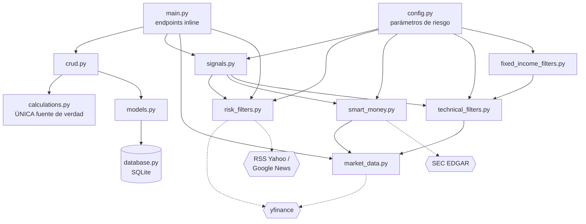
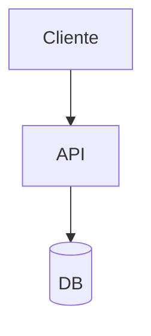

# CLAUDE.md — Convenciones del repo

## Qué es este proyecto

Simulador de paper trading que evoluciona hacia un **bot de trading cuantitativo**
para CEDEARs y bonos soberanos/provinciales argentinos, operando vía la API de
InvertirOnline (IOL).

El punto de partida es una digitalización de `Simulador_Inversiones_IA_Paper_Trading.xlsx`:
se cargan operaciones a mano, se calculan comisiones con las fórmulas exactas de la
planilla y el dashboard dice si la estrategia rinde de verdad. Encima de esa base se
construyen, por fases, los filtros técnicos, los filtros de riesgo/noticias, la
integración con IOL y la ejecución automática.

El plan completo, fase por fase, está en `tareasdesarrollo.md` (raíz del repo).

## Estructura de carpetas

```
backend/                 API FastAPI + SQLite (SQLAlchemy)
  app/
    main.py              Endpoints HTTP. Todo inline, sin routers.
    models.py            Tablas SQLAlchemy (BrokerConfig, Trade)
    schemas.py           Modelos Pydantic de entrada/salida
    crud.py              Acceso a datos y armado del dashboard
    calculations.py      Fórmulas de comisiones — ÚNICA fuente de verdad matemática
    database.py          Engine, sesión, Base
    config.py            Parámetros de riesgo y universos de tickers/bonos
    market_data.py       Precios e histórico OHLCV (yfinance)
    technical_filters.py ATR, EMAs y los 7 filtros de validación (acciones/CEDEARs)
    fixed_income_filters.py  Filtros institucionales de renta fija (bonos)
    risk_filters.py      Circuit breaker de VIX y sentimiento de noticias (FinBERT)
    smart_money.py       RVOL y compras de insiders (SEC Form 4)
    signals.py           Orquestación del escaneo de señales
  tests/                 pytest
  requirements.txt
  seed.py                Carga las 5 operaciones de ejemplo del Excel
frontend/                Next.js (App Router) + Tailwind
  app/                   page.tsx (Dashboard), simulador/, senales/, config/
  components/            Nav, MetricCard, NewTradeForm, CloseTradeRow
  lib/                   api.ts (cliente HTTP), types.ts, format.ts
deploy/                  Units systemd para el VPS (Tarea 10.3)
  tradingbot-api.service       uvicorn en 127.0.0.1:8123
  tradingbot-scanner.service   scanner_job.py, escaneo 24/7
docs/                    Manuales originales (.docx) + parametros-riesgo.md
  specs-txt/             Texto plano extraído de los .docx, para consulta rápida
```

### Cómo dependen los módulos del backend



> [!note] Cómo leer el diagrama
> Las flechas punteadas salen a internet. Todo lo que cruza esa línea tiene que
> devolver un resultado controlado ante error — ver "Convenciones de código".

## Reglas de trabajo

### Al terminar CADA tarea, agregar una entrada a `PROGRESS.md`

Formato obligatorio, al final del archivo:

```markdown
## YYYY-MM-DD — Tarea X.Y — Título

**Qué se hizo:** una o dos frases.
**Archivos tocados:** lista.
**Cómo se probó:** comando corrido y salida real (pegar la salida, no describirla).
**Pendiente / notas:** lo que quedó abierto, si algo quedó abierto.
```

> [!warning] No inventar salidas de tests
> Si algo no se pudo probar, decirlo explícitamente.

### Convenciones de código

- **Backend en español**: nombres de campos, endpoints y mensajes de veto en español
  (`/senales`, `precio_entrada`, `"VETO EARNINGS: ..."`), porque replican los manuales
  y el Excel original. El código en sí (funciones, variables internas) puede ir en
  español también — mantener el estilo de los archivos existentes.
- **`calculations.py` no se toca sin tests.** Es la única fuente de verdad de las
  fórmulas de comisiones; cualquier cambio debe pasar por `backend/tests/test_calculations.py`.
- **Nada de credenciales hardcodeadas.** Todo desde variables de entorno vía
  `python-dotenv`. Actualizar `.env.example` cuando se agrega una clave nueva.
- **Los módulos de datos externos nunca rompen el proceso.** `market_data`,
  `risk_filters` y `smart_money` hablan con internet: toda función devuelve un
  resultado controlado ante error, nunca propaga la excepción hacia el endpoint.
- **Los filtros devuelven `(bool, dict)`**, con `dict["motivo"]` cuando el bool es
  `False`. Los motivos de veto se pierden nunca: se listan aparte en la respuesta.
- **`main.py` mantiene los endpoints inline**, agrupados por sección con comentarios
  `# ---------- Nombre ----------`, como ya está.
- **Frontend**: componentes con `"use client"` cuando usan estado, tipos en
  `lib/types.ts`, llamadas centralizadas en `lib/api.ts`.

### Parámetros de riesgo

No hardcodear capital, máximo de posiciones, stop-loss ni ratio R/B en los módulos.
Todo sale de `backend/app/config.py`, que a su vez documenta sus valores en
`docs/parametros-riesgo.md`.

## Reglas de documentación visual

Estas reglas aplican a TODO archivo `.md` que generes o edites en este repo:
README, progress, notas, decisiones técnicas, changelogs, etc.

El objetivo: que se lea bien en Obsidian (local, con Mermaid, tablas y callouts
renderizados), no como un paredón de texto plano.

### Formato obligatorio

#### 1. Arquitectura, flujos, estados, secuencias → Mermaid, nunca prosa

Si vas a explicar cómo se conectan módulos, el flujo de un pedido, una
máquina de estados, o el orden de llamadas entre servicios, usa un bloque:



Tipos según el caso:

| Caso | Tipo de diagrama |
|---|---|
| Arquitectura / flujos | `flowchart` |
| Llamadas entre componentes | `sequenceDiagram` |
| Esquemas de datos | `erDiagram` |
| Máquinas de estado | `stateDiagram-v2` |
| Cronogramas de progreso | `gantt` |

#### 2. Comparaciones, opciones evaluadas, pros/contras → tabla

Nunca lista de párrafos. Ejemplo: si evaluaste 2 librerías o 2 enfoques, va en
tabla con columnas tipo `Opción | Pros | Contras | Elegido`.

#### 3. Decisiones, warnings, pendientes, notas importantes → callouts

No texto suelto.

```
> [!note] Decisión
> Se eligió X por Y motivo.

> [!warning] Pendiente
> Falta definir el manejo de reintentos en el webhook.

> [!todo] Próximo paso
> Migrar el endpoint legacy antes del release.
```

#### 4. Secciones largas → siempre bajo un header con jerarquía clara

Usá `##` y `###` para que colapsen bien en Obsidian. Nunca un bloque de más de
~15 líneas sin subtítulo.

#### 5. Capturas o diagramas de UI

Si el cambio toca interfaz, referenciá dónde debería ir la imagen
(``) aunque la imagen la agregue yo después
a mano.

#### 6. Progress/changelog

Cada entrada nueva va con fecha, un callout de tipo resumen, y — si tocó
arquitectura o flujo — su diagrama Mermaid. No apendear texto corrido al final
del archivo.

### Qué NO hacer

- No expliques en prosa algo que se entiende mejor en tabla o diagrama.
- No metas un cambio nuevo al final del `.md` sin estructurar la sección.
- No dupliques info que ya está en un diagrama con un párrafo que dice lo mismo.

### Migración retroactiva (una sola vez)

Cuando te pida "migrá la documentación vieja", hacé esto:

1. Recorré todos los `.md` existentes del repo (README, progress, docs internas).
2. Para cada uno, identificá:
   - Bloques de texto que describen arquitectura/flujo/secuencia → convertilos a Mermaid.
   - Bloques que comparan opciones o listan pros/contras → convertilos a tabla.
   - Decisiones tomadas, warnings o pendientes mencionados en prosa → convertilos a callouts.
3. Conservá el contenido y el significado exacto — es un cambio de formato,
   no de contenido. No inventes ni resumas de más.
4. Si un archivo de progress tiene múltiples entradas históricas, separalas
   con headers `##` por fecha/sesión en vez de dejarlas corridas.
5. Al terminar cada archivo, mostrame un resumen corto de qué convertiste
   (ej. "3 flujos a Mermaid, 1 tabla comparativa, 4 callouts") antes de pasar al siguiente.

## Cómo correr

```bash
# Backend
cd backend
./venv/Scripts/python.exe -m uvicorn app.main:app --reload --port 8123   # Windows
# source venv/bin/activate && uvicorn app.main:app --reload --port 8123  # Linux/Mac

# Tests
cd backend && ./venv/Scripts/python.exe -m pytest -v

# Frontend
cd frontend && npm run dev
```

El frontend lee la URL del backend de `frontend/.env.local` (`NEXT_PUBLIC_API_URL`).
