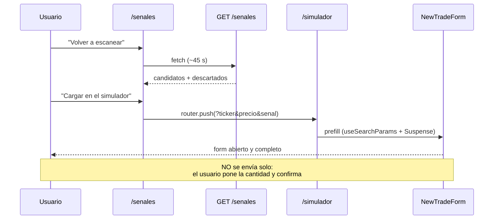
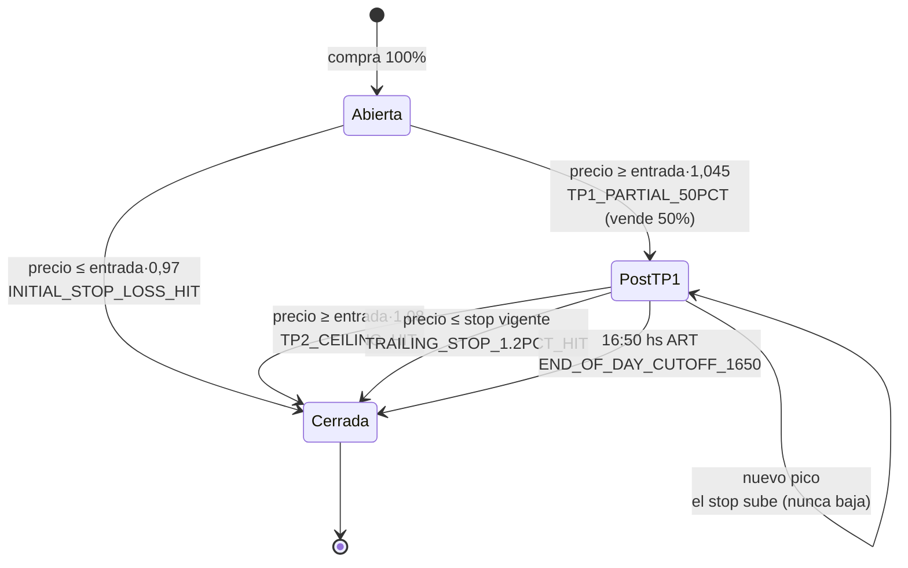
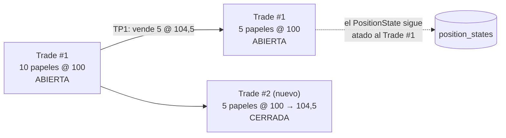
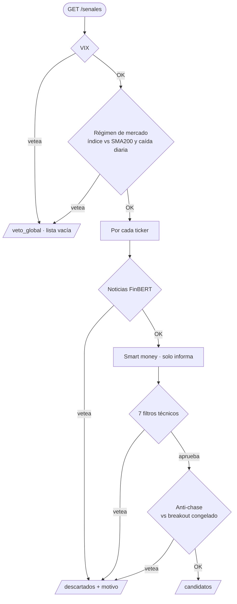
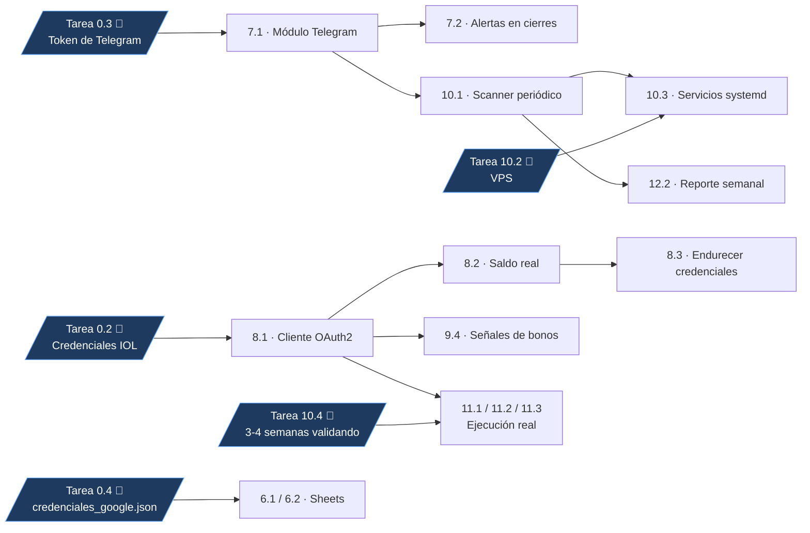

# PROGRESS.md — Historial de tareas

Una entrada por tarea resuelta, en orden cronológico. El formato está fijado en
`CLAUDE.md`. La lista completa de tareas está en `tareasdesarrollo.md`.

---

## 2026-08-29 — Entrada retroactiva — Estado del proyecto al arrancar

> [!summary] Qué se hizo
> nada en esta entrada; documenta el punto de partida sobre el que
> se construye todo lo que sigue.

Estado al momento de escribir esto:

- **Backend** FastAPI + SQLite (SQLAlchemy 2.0), corriendo en el puerto 8123.
  - `calculations.py` replica las fórmulas del Excel
    `Simulador_Inversiones_IA_Paper_Trading.xlsx`: costo por tramo
    `(comisión + derechos) × (1 + IVA)`, y de ahí comisiones de compra/venta,
    resultado neto y rendimiento neto %.
  - Modelos `BrokerConfig` (fila única con las tasas) y `Trade` (una fila por
    operación de paper trading, con `tipo` ∈ CEDEAR/ACCION/BONO).
  - Endpoints: `/health`, `GET|PUT /broker-config`, CRUD de `/trades`,
    `POST /trades/{id}/cerrar` y `GET /dashboard`.
  - Los campos calculados **no se guardan**: se derivan al vuelo, así nunca se
    desincronizan con la config de comisiones vigente.
  - `seed.py` carga las 5 operaciones de ejemplo de la planilla original.
- **Frontend** Next.js (App Router) + Tailwind, con tres páginas: Dashboard (`/`),
  Simulador (`/simulador`) y Configuración (`/config`).
- **Docs**: los cinco manuales originales en `docs/` (`.docx`).

**Archivos tocados:** ninguno.

**Cómo se probó:** no aplica.

> [!note] Pendiente / notas
> el simulador de paper trading funciona; falta todo lo que
> está en `tareasdesarrollo.md` de la Fase 2 en adelante.

---

## 2026-08-29 — Tarea 1.2 — Documentar convenciones del repo para Claude Code

> [!summary] Qué se hizo
> se creó `CLAUDE.md` con la descripción del proyecto, la estructura
> de carpetas, las convenciones de código (backend en español, `calculations.py` no se
> toca sin tests, nada de credenciales hardcodeadas, filtros que devuelven
> `(bool, dict)` con motivo) y la instrucción explícita de agregar una entrada a
> `PROGRESS.md` al terminar cada tarea. Se creó este `PROGRESS.md` con la entrada
> retroactiva de arriba.

Extra fuera del alcance estricto de la tarea, hecho para desbloquear las tareas que
lo necesitan: se extrajo el texto de los cinco `.docx` de `docs/` a
`docs/specs-txt/*.txt`, para poder citar el código de los manuales sin depender de
abrir Word.

**Archivos tocados:** `CLAUDE.md` (nuevo), `PROGRESS.md` (nuevo),
`docs/specs-txt/*.txt` (nuevos, generados).

**Cómo se probó:** no aplica — son archivos de documentación.

> [!note] Pendiente / notas
> ninguna.

---

## 2026-08-29 — Tarea 0.1 (parcial, PROVISORIA) — Parámetros de riesgo

> [!summary] Qué se hizo
> la Tarea 0.1 es 👤 (humana) y no está resuelta, pero las tareas
> 3.2, 9.2 y 11.2 leen `docs/parametros-riesgo.md`. Para desbloquearlas se creó ese
> documento **cargado con los valores por defecto de los manuales**, marcado en grande
> como PROVISORIO y pendiente de confirmación humana. En paralelo se creó
> `backend/app/config.py`, que es de dónde los importa el código (ningún módulo
> hardcodea estos números).

Valores cargados: `CAPITAL_TOTAL` $100.000 ARS, `MAX_POSICIONES` 2,
`MONTO_POR_POSICION` $50.000, `STOP_LOSS_MAX_PCT` 3,0%, `TAKE_PROFIT_RATIO` 1:2,
`VIX_NIVEL_PANICO` 25,0, `SENTIMIENTO_MIN_ACCIONES` -0,35,
`SENTIMIENTO_MIN_BONOS` -0,30, `SPREAD_BID_ASK_MAX` 0,6%,
`EJECUCION_REAL_HABILITADA` false.

**Archivos tocados:** `docs/parametros-riesgo.md` (nuevo), `backend/app/config.py` (nuevo).

**Cómo se probó:** import del módulo sin errores (ver entrada de la Tarea 9.1).

> [!warning] Pendiente / notas
> **estos números no están acordados con el dueño del
> capital.** Hay que revisarlos y firmarlos antes de la Fase 11 (dinero real).

---

## 2026-08-29 — Tarea 1.3 — Tests automatizados de las fórmulas de comisión

> [!summary] Qué se hizo
> se cubrió `app/calculations.py` con 8 tests: las 5 operaciones de
> ejemplo del Excel (AAPL, NVDA, NXE, MELI, TSLA) con los resultados netos calculados
> a mano contra la fórmula de la planilla, el test de `BrokerRates` (0,7018% por tramo
> / 1,4036% ida y vuelta), un caso de posición abierta y uno de break-even.

Valores esperados usados (tasa 0,007018), calculados aparte y puestos como literales
—no recalculados con la función bajo test—:

| Ticker | cant × entrada → salida | costo_total_entrada | monto_neto_cobrado | resultado_neto |
|---|---|---|---|---|
| AAPL | 25 × 12500 → 13450 | 314.693,125 | 333.890,1975 | **+19.197,07** |
| NVDA | 15 × 18200 → 17600 | 274.915,914 | 262.147,248 | **−12.768,67** |
| NXE | 84 × 9400 → 10150 | 795.141,4128 | 846.616,4532 | **+51.475,04** |
| MELI | 8 × 38500 → 38900 | 310.161,544 | 309.015,9984 | **−1.145,55** |
| TSLA | 12 × 22100 → 21300 | 267.061,1736 | 253.806,1992 | **−13.254,97** |

**Archivos tocados:** `backend/tests/test_calculations.py`, `backend/tests/__init__.py`,
`backend/conftest.py` (nuevos). `backend/requirements.txt` (pytest + httpx).

**Cómo se probó:** `cd backend && ./venv/Scripts/python.exe -m pytest tests/test_calculations.py -v`
→ `8 passed in 0.11s`.

> [!note] Pendiente / notas
> ninguna.

---

## 2026-08-29 — Tarea 2.1 — Módulo de precios en vivo con yfinance

> [!summary] Qué se hizo
> `app/market_data.py` con `get_last_price(ticker)`,
> `get_history(ticker, period="60d")`, la excepción propia `MarketDataError` y una
> cache en memoria con TTL de 5 minutos (`TTL_CACHE_SEGUNDOS = 300`) que evita
> repetir el pedido del histórico de SPY en cada ticker del escaneo.

Dos decisiones que importan aguas abajo:
- `get_history` devuelve `df.copy()`, así los módulos que agregan columnas EMA no
  ensucian el DataFrame cacheado.
- Se silencia el logger de yfinance, que ante ticker inválido imprimía un
  `HTTP Error 404` que parecía un stacktrace sin manejar.

**Archivos tocados:** `backend/app/market_data.py`, `backend/tests/test_market_data.py` (nuevos).

**Cómo se probó:**

```
get_last_price('AAPL') = 319.70001220703125
get_history('AAPL')    -> shape=(60, 7)
  columnas: ['Open','High','Low','Close','Volume','Dividends','Stock Splits']
get_last_price('XXXX123') -> MarketDataError: Sin datos de mercado para 'XXXX123'
  (periodo 5d). Verifica el ticker; si es un instrumento local acordate del sufijo '.BA'.
cache: 1ra llamada get_history('SPY') 0.299s | 2da (cache) 0.000s
```

`pytest tests/test_market_data.py -v` → `10 passed`.

> [!note] Pendiente / notas
> `Ticker.history()` devuelve **7 columnas**, no 5 (OHLCV +
> `Dividends` + `Stock Splits`), y el índice es un `DatetimeIndex` con timezone.

---

## 2026-08-29 — Tarea 2.2 — Autocompletar precio actual en el simulador

> [!summary] Qué se hizo
> endpoint `GET /market/precio/{ticker}` en el backend (404 con
> `detail` en español si el ticker no existe) y botón **"Usar precio de mercado"**
> en `NewTradeForm.tsx`, con estado "Buscando…", deshabilitado si el ticker está
> vacío, y el `detail` del 404 mostrado como error legible.

**Archivos tocados:** `backend/app/main.py`, `backend/app/schemas.py`,
`frontend/components/NewTradeForm.tsx`, `frontend/lib/api.ts`, `frontend/lib/types.ts`.

**Cómo se probó:** contra el backend real:

```
GET /market/precio/AAPL     -> {"ticker":"AAPL","precio":319.70001220703125}
GET /market/precio/XXXX123  -> HTTP 404 {"detail":"Sin datos de mercado para 'XXXX123' ..."}
```

`npx tsc --noEmit` sin errores y `npm run build` compila.

> [!note] Pendiente / notas
> el botón se probó vía el HTML servido y el endpoint real;
> no se hizo una captura de pantalla del click en el navegador.

---

## 2026-08-29 — Tarea 3.1 — Cálculo de ATR y medias móviles

> [!summary] Qué se hizo
> `app/technical_filters.py` con `calculate_atr(df, period=None)`
> (cae en `config.ATR_PERIODO`), `calculate_ema(serie, span)` y
> `agregar_emas(df, spans=(20,50))`, que trabaja sobre una copia y no muta el
> DataFrame recibido.

**Archivos tocados:** `backend/app/technical_filters.py`,
`backend/tests/test_technical_filters.py` (nuevos).

**Cómo se probó:** contra el histórico real de AAPL (60 ruedas):

```
ATR(14) ultimo: 6.0371   (NaN? False)
EMA20 ultimo  : 312.8013
EMA50 ultimo  : 312.2875
Close ultimo  : 319.7
columnas del df original intactas (no mutado):
  ['Open','High','Low','Close','Volume','Dividends','Stock Splits']
```

Valores positivos y sin NaN al final de la serie. Más 10 tests deterministas
(ATR de serie plana = rango diario, gap agranda el TR, EMA20 > EMA50 en tendencia
alcista, no-mutación).

> [!note] Pendiente / notas
> ninguna.

---

## 2026-08-29 — Tarea 3.2 — Los 7 filtros de validación técnica

> [!summary] Qué se hizo
> `evaluate_7_filters(ticker)` en `technical_filters.py`: earnings,
> régimen SPY vs EMA50, tendencia precio > EMA20 > EMA50, fuerza relativa vs SPY a
> 30 ruedas, stop por ATR con tope de riesgo, y take-profit por ratio R/B. Todos los
> parámetros salen de `config.py` (nada hardcodeado).

Dos correcciones deliberadas sobre el código del manual:

| Caso | Qué hace el manual | Qué hace este repo | Por qué |
|---|---|---|---|
| Datos insuficientes | Devuelve `False, {}` | **Siempre** hay `detalle["motivo"]` | Sin motivo se pierde la trazabilidad de por qué no se operó |
| `yf.Ticker().calendar` | Asume DataFrame | Maneja `dict` y DataFrame; si no puede determinar la fecha, **no vetea** | Las versiones nuevas de yfinance devuelven `dict`, y un dato faltante no debe inventar un veto |

**Archivos tocados:** `backend/app/technical_filters.py`.

**Cómo se probó:** contra 5 tickers reales del universo BYMA:

| Ticker | Resultado | Detalle |
|---|---|---|
| AAPL | VETADO | VETO RS: no supera a SPY en 30 ruedas (-2.03% vs 3.67%) |
| NVDA | VÁLIDO | entrada 217,55 · SL 211,02 · TP 230,60 · riesgo 3,0% |
| MELI | VÁLIDO | entrada 1966,25 · SL 1907,26 · TP 2084,22 · riesgo 3,0% |
| TSLA | VETADO | VETO TÉCNICO: no se cumple precio > EMA20 > EMA50 (348.75 / 345.12 / 358.06) |
| KO | VÁLIDO | entrada 89,66 · SL 87,60 · TP 93,77 · riesgo 2,29% |

Los resultados son coherentes con el gráfico: TSLA cotiza debajo de su EMA50, y KO
sale con 2,29% — o sea el recorte al tope no se aplica siempre, discrimina bien.

> [!warning] Pendiente / notas
> el manual recorta el stop al 3,0% solo si el riesgo supera
> el **3,5%**. Se respetó tal cual, pero implica que el riesgo real por operación puede
> llegar hasta 3,5% pese a que `STOP_LOSS_MAX_PCT` diga 3,0% (se vio en AMZN: 3,27%).
> Vale revisarlo al confirmar la Tarea 0.1.

---

## 2026-08-29 — Tarea 3.3 — Endpoint de escaneo de señales

> [!summary] Qué se hizo
> `app/signals.py` con `escanear_senales(tickers=None)` y el endpoint
> `GET /senales`. Recorre `config.TICKERS_BYMA` y devuelve `candidatos` y
> `descartados` — **ningún motivo de veto se pierde**, van todos en `descartados`.
> También se agregó `GET /config/universo` para inspeccionar los universos.

**Archivos tocados:** `backend/app/signals.py` (nuevo), `backend/app/main.py`,
`backend/app/schemas.py`.

**Cómo se probó:** `GET /senales` real, HTTP 200 en 44 s — 4 candidatos, 6 descartados.
Respuesta completa: ver la entrada de la Tarea 4.3 más abajo (es la misma corrida,
ya con el veto de riesgo integrado).

> [!note] Pendiente / notas
> 44 segundos es lento para un request HTTP; la Fase 10 (scanner
> job) lo resuelve escaneando en background en vez de a pedido.

---

## 2026-08-29 — Tarea 3.4 — Página "Señales" en el frontend

> [!summary] Qué se hizo
> `frontend/app/senales/page.tsx`, agregada al `Nav` entre Simulador
> y Configuración. Muestra el estado del VIX, un cartel rojo si el circuit breaker
> está activo, la tabla de señales válidas (ticker, precio, SL, TP, riesgo y el
> contexto de RVOL/insiders/sentimiento) y una segunda tabla con los descartados y
> su motivo. Botón **"Cargar en el simulador"** por señal válida, que navega a
> `/simulador?ticker=&precio=&senal=` y prellena el formulario **sin crear la
> operación**.

### Flujo de prellenado



**Archivos tocados:** `frontend/app/senales/page.tsx` (nuevo),
`frontend/components/Nav.tsx`, `frontend/components/NewTradeForm.tsx`
(prop `prefill`), `frontend/app/simulador/page.tsx` (lee los query params con
`useSearchParams` dentro de un `Suspense`).

**Cómo se probó:** `npm run build` compila con la ruta `/senales` incluida;
`npx tsc --noEmit` sin errores. Flujo de prellenado verificado sobre el HTML servido:

```
GET /simulador?ticker=NVDA&precio=217.55&senal=...  -> HTTP 200
  value="NVDA"        presente
  value="217.55"      presente
  "Guardar operacion" presente (form abierto, NO enviado solo)
GET /simulador (sin params) -> form cerrado, muestra "+ Nueva operacion"
```

> [!note] Pendiente / notas
> no se tomó captura de pantalla; la verificación fue sobre el
> HTML renderizado y el endpoint real.

---

## 2026-08-29 — Tarea 4.1 — Circuit breaker de VIX

> [!summary] Qué se hizo
> `app/risk_filters.py` con `estado_vix()` (datos crudos para el
> dashboard) y `check_vix_circuit_breaker()` apoyado en ella. Veta si el VIX supera
> `config.VIX_NIVEL_PANICO` o si subió más de `config.VIX_SUBA_DIARIA_MAX` en el día.
> Endpoint `GET /riesgo/vix`.

Criterio ante error: **fail-safe, vetea**. Sin saber si el mercado está en pánico
no se abre posición (es el criterio del manual).

**Archivos tocados:** `backend/app/risk_filters.py` (nuevo), `backend/app/main.py`,
`backend/app/schemas.py`.

**Cómo se probó:**

```
GET /riesgo/vix -> {"vix_actual":14.43,"vix_previo":14.51,"cambio_pct":-0.0055,
                    "veto":false,"motivo":"VIX OK (14.43, -0.6% diario)"}
```

14,43 coincide con el cierre real del VIX del 2026-08-28. Más tests con el VIX
mockeado: nivel de pánico vetea, suba abrupta vetea, error de red vetea.

> [!note] Pendiente / notas
> ninguna.

---

## 2026-08-29 — Tarea 4.2 — Filtro de sentimiento de noticias (FinBERT)

> [!summary] Qué se hizo
> `get_finbert_sentiment(ticker)` en `risk_filters.py`. Lee el RSS de
> Yahoo Finance, veta por palabra crítica, y si no, promedia el score de los últimos
> 5 titulares con FinBERT (`ProsusAI/finbert`) corriendo local, vetando bajo
> `config.SENTIMIENTO_MIN_ACCIONES`.

**El modelo se carga perezosamente y cacheado** con `functools.lru_cache(maxsize=1)`,
y `torch`/`transformers` se importan *dentro* de esa función: si se cargara a nivel
de módulo como en el manual, `import app.main` bajaría 400 MB antes de servir el
primer request. Si las librerías no están, el módulo se importa igual y el veto por
palabras críticas sigue funcionando (degradación segura).

Criterio ante error: **fail-open, no vetea**. Un 429 de Yahoo no es riesgo del activo.

**Archivos tocados:** `backend/app/risk_filters.py`, `backend/requirements.txt`.

**Cómo se probó:** contra tickers reales:

| Ticker | Score | Titular usado |
|---|---|---|
| AAPL | +0,0678 | "John Ternus Becomes Apple's CEO on Sept. 1..." (−0,0173) |
| NVDA | +0,0489 | "Peter Thiel's Fund Reported Zero Stocks for 2 Straight Quarters..." (−0,0305) |
| TSLA | −0,2277 | "Tesla Stock in 2027: Why I Think TSLA Still Has Room to Run" (+0,1841) |

TSLA da negativo pero por encima del umbral de −0,35, así que no vetea.

> [!warning] Pendiente / notas
> **`torch` + `transformers` pesan ~2,5 GB instalados y
> FinBERT necesita ~1 GB de RAM para inferencia. Un VPS free tier de 512 MB–1 GB NO
> alcanza.** Está anotado en `requirements.txt` y en el `README`. Si el deploy va a un
> servidor chico, hay que sacar esas dos líneas: el módulo degrada solo.

---

## 2026-08-29 — Tarea 4.3 — Integrar el veto de riesgo al escaneo de señales

> [!summary] Qué se hizo
> `signals.py` aplica el orden del manual: **VIX → noticias → smart
> money → 7 filtros**. Si el circuit breaker vetea, devuelve lista vacía con
> `veto_global` y **no evalúa ningún ticker**. Si el sentimiento vetea un ticker, se
> descarta con ese motivo sin llegar a los filtros técnicos.

### Orden de chequeos implementado


> [!warning] Bug encontrado y corregido en el camino
> El manual matchea las palabras críticas con `if palabra in titulo`, o sea
> subcadena. En la corrida real eso vetó **SPY y MSFT** porque `"war"` matcheaba
> dentro de "hard**war**e" y "soft**war**e". Un veto es la decisión de no operar:
> no puede dispararse por letras en el medio de otra palabra. Se reemplazó por un
> patrón con límites de palabra, que sigue soportando frases ("bank run",
> "cesación de pagos") y acentos.

**Archivos tocados:** `backend/app/signals.py`, `backend/app/risk_filters.py`,
`backend/tests/test_signals.py`, `backend/tests/test_risk_filters.py`.

**Cómo se probó:** test que mockea `check_vix_circuit_breaker` con veto y confirma
que `/senales` devuelve lista vacía con el motivo, más otro que verifica que **no se
evalúa ningún ticker** cuando el VIX corta. Respuesta real de `GET /senales`
(HTTP 200, 44 s):

```json
{
  "generado": "2026-08-29T23:36:09",
  "universo": ["AAPL","NVDA","MELI","SPY","QQQ","KO","MSFT","AMZN","GOOGL","TSLA"],
  "veto_global": null,
  "vix": {"vix_actual": 14.43, "vix_previo": 14.51, "cambio_pct": -0.0055,
          "veto": false, "motivo": "VIX OK (14.43, -0.6% diario)"},
  "candidatos": [
    {"ticker":"NVDA","precio_entrada":217.55,"stop_loss":211.02,"take_profit":230.6,
     "pct_riesgo":3.0,"sentimiento_score":0.0489,"rvol":1.55,"es_acumulacion":false,
     "insiders_detectados":true,"insiders_detalle":"Insiders detectados: 40 filings Form 4 en NVDA"},
    {"ticker":"MELI","precio_entrada":1966.25,"stop_loss":1907.26,"take_profit":2084.22,
     "pct_riesgo":3.0,"sentimiento_score":0.0319,"rvol":0.68,"es_acumulacion":false,
     "insiders_detectados":true,"insiders_detalle":"Insiders detectados: 40 filings Form 4 en MELI"},
    {"ticker":"KO","precio_entrada":89.66,"stop_loss":87.6,"take_profit":93.77,
     "pct_riesgo":2.29,"sentimiento_score":0.0126,"rvol":0.69,"es_acumulacion":false,
     "insiders_detectados":true,"insiders_detalle":"Insiders detectados: 40 filings Form 4 en KO"},
    {"ticker":"AMZN","precio_entrada":266.43,"stop_loss":257.72,"take_profit":283.84,
     "pct_riesgo":3.27,"sentimiento_score":0.0682,"rvol":1.17,"es_acumulacion":false,
     "insiders_detectados":true,"insiders_detalle":"Insiders detectados: 40 filings Form 4 en AMZN"}
  ],
  "descartados": [
    {"ticker":"AAPL","motivo":"VETO RS: no supera a SPY en 30 ruedas (-2.03% vs 3.67%)."},
    {"ticker":"SPY","motivo":"VETO CISNE NEGRO: Palabra critica 'war' detectada en 'Optics Stocks Slide as AI Hardware Trade Cools...'"},
    {"ticker":"QQQ","motivo":"VETO TECNICO: estructura no alcista, no se cumple precio > EMA20 > EMA50 (716.43 / 714.22 / 715.03)."},
    {"ticker":"MSFT","motivo":"VETO CISNE NEGRO: Palabra critica 'war' detectada en 'Microsoft, Palantir Among Stocks To Watch As Software Bounces Back'"},
    {"ticker":"GOOGL","motivo":"VETO TECNICO: estructura no alcista, no se cumple precio > EMA20 > EMA50 (346.59 / 346.47 / 350.97)."},
    {"ticker":"TSLA","motivo":"VETO TECNICO: estructura no alcista, no se cumple precio > EMA20 > EMA50 (348.75 / 345.12 / 358.06)."}
  ]
}
```

> Esta corrida es **anterior** al fix de palabras críticas — se dejó tal cual porque
> es la evidencia del bug: ahí se ven SPY y MSFT vetados por el falso positivo de
> "war" dentro de "hardware" y "software". Con el fix aplicado esos dos vuelven a
> evaluarse técnicamente. Verificación del fix:
>
> ```
> 'Optics Stocks Slide as AI Hardware Trade Cools'          -> None (antes: 'war')
> 'Microsoft, Palantir ... As Software Bounces Back'        -> None (antes: 'war')
> 'Warner Bros posts quarterly results'                     -> None
> 'Israel-Hamas war escalates, oil spikes'                  -> 'war'
> 'Bank run at regional lender triggers panic'              -> 'bank run'
> 'SEC probe into accounting practices widens'              -> 'sec probe'
> 'Advierten por una cesacion de pagos inminente' (acento)  -> 'cesacion de pagos'
> ```

> [!note] Pendiente / notas
> ninguna.

---

## 2026-08-29 — Tareas 5.1 y 5.2 — Smart money: RVOL e insiders (SEC Form 4)

> [!summary] Qué se hizo
> `app/smart_money.py` con `check_unusual_volume(ticker)`,
> `check_bond_unusual_volume(ticker_yf)`, `check_sec_form4_cluster(ticker)` y
> `contexto_smart_money(ticker, es_bono=False)`. Los campos `rvol`, `es_acumulacion`,
> `insiders_detectados` e `insiders_detalle` viajan en cada candidato de `/senales`.

**Es contexto informativo, nunca vetea una señal** — hay un test que lo fija.

**Archivos tocados:** `backend/app/smart_money.py`,
`backend/tests/test_smart_money.py` (nuevos), `backend/app/signals.py`,
`backend/app/schemas.py`.

**Cómo se probó:**

```
=== Tabla ticker -> RVOL ===
TICKER      RVOL   ES_ACUMULACION
AAPL        0.81            False
NVDA        1.55            False
TSLA        0.99            False

=== check_sec_form4_cluster ===
AAPL -> (True, 'Insiders detectados: 40 filings Form 4 en AAPL')
NVDA -> (True, 'Insiders detectados: 40 filings Form 4 en NVDA')
NOEXISTE123 -> (False, 'SEC EDGAR no devolvio Atom para NOEXISTE123: probablemente
                el ticker no mapea a un CIK (respuesta HTML de error).')

=== contexto_smart_money('AAPL') ===
{'rvol': 0.81, 'es_acumulacion': False, 'insiders_detectados': True,
 'insiders_detalle': 'Insiders detectados: 40 filings Form 4 en AAPL'}
```

`pytest tests/test_smart_money.py` → `25 passed`.

> [!warning] Pendiente / notas
> **el conteo de Form 4 satura.** El feed de EDGAR pagina de
> a 40 y no filtra por fecha, así que AAPL, NVDA y TSLA devuelven exactamente 40. Con
> `INSIDERS_MIN_FILINGS=2`, cualquier emisor grande da `True` casi siempre. Se lee
> como "hay actividad de insiders registrada", **no** como "cluster de compras esta
> semana", y no distingue compra (código P) de venta ni de ejercicio de opciones —
> eso exigiría abrir cada filing, fuera del alcance de la 5.2. Como es contexto y no
> filtro, no afecta ninguna decisión, pero conviene no leerlo como señal alcista.

⚠️ **Bonos: Yahoo Finance no tiene datos.** `AL30.BA` y `GD30.BA` devuelven
`MarketDataError`. Por eso `check_bond_unusual_volume` devuelve `(True, 1.0)` sin
bloquear (criterio del manual de bonos). En la práctica el RVOL de bonos hoy es
siempre neutro; el dato real habría que sacarlo de IOL.

---

## 2026-08-29 — Tarea 9.2 — Filtros institucionales para renta fija

> [!summary] Qué se hizo
> `app/fixed_income_filters.py` con
> `evaluate_bond_filters(simbolo, precio_mercado, df_historico, ahora=None)` (veto por
> corte de cupón, tendencia vs EMA20, stop por ATR con tope estricto de 3,0%,
> take-profit por ratio) y `check_spread_bid_ask(compra, venta, ultimo)` como función
> separada y reusable, extraída del `ejecutar_ciclo` de `bot_bonds.py`.

El parámetro `ahora=` se agregó para poder testear el veto de cupón sin depender del
mes en que se corra.

**Archivos tocados:** `backend/app/fixed_income_filters.py`,
`backend/tests/test_fixed_income_filters.py` (nuevos).

**Cómo se probó:**

| Bono | Escenario | Resultado | Motivo / detalle |
|---|---|---|---|
| AL30 | sin histórico | VÁLIDO | entrada 72,50 · SL 70,33 · TP 76,85 · riesgo 3,0% · `datos_limitados=True` |
| GD30 | sin histórico | VÁLIDO | entrada 78,30 · SL 75,95 · TP 83,00 · riesgo 3,0% |
| BA37D | sin histórico (provincial) | VÁLIDO | entrada 61,20 · SL 59,36 · TP 64,87 · riesgo 3,0% |
| AL30 | serie alcista sintética | VÁLIDO | entrada 74,14 · SL 72,64 · TP 77,14 · riesgo 2,02% |
| GD30 | serie bajista sintética | VETADO | VETO TENDENCIA: cotiza a $73,49, debajo de su EMA20 ($75,06) |
| AL30 | forzando 2027-01-05 | VETADO | VETO CORTE CUPÓN: paga en el mes 1 y hoy es 05/01, dentro de la ventana (días 1 a 12) |

```
check_spread_bid_ask(72.40, 72.60, 72.50) -> (True,  spread 0.28% dentro del maximo de 0.60%)
check_spread_bid_ask(71.00, 74.00, 72.50) -> (False, VETO SPREAD: 4.14% supera el maximo de 0.60%)
check_spread_bid_ask(0, 0, 0)             -> (False, VETO SPREAD: sin cotizacion) - sin division por cero
```

`pytest tests/test_fixed_income_filters.py` → `13 passed`.

> [!note] Pendiente / notas
> los bonos argentinos no tienen histórico en Yahoo Finance, así
> que en producción el camino real va a ser el **modo degradado** (`datos_limitados`)
> hasta que la Tarea 9.4 traiga cotizaciones de IOL. Por eso los caminos de EMA20 y
> ATR se probaron con series sintéticas: con datos reales hoy no se alcanzan.

---

## 2026-08-29 — Tarea 9.3 — Filtro de noticias de deuda soberana

> [!summary] Qué se hizo
> `check_bonds_news_sentiment(simbolo_bono)` en `risk_filters.py`, con
> el feed de Google News en español (`hl=es-419&gl=AR`), las palabras críticas de deuda
> del manual y el umbral `config.SENTIMIENTO_MIN_BONOS`. Reusa el mismo modelo FinBERT
> cacheado que la Tarea 4.2 (no se carga dos veces).

Se normalizan los titulares (minúsculas + sin tildes) antes de comparar: los
titulares en español vienen acentuados ("cesación de pagos") y la lista del manual
está sin acentos, así que sin normalizar la mitad de las palabras nunca matchearía.

**Archivos tocados:** `backend/app/risk_filters.py`, `backend/tests/test_risk_filters.py`.

**Cómo se probó:**

| Bono | Score | Veto | Titular usado |
|---|---|---|---|
| AL30 | +0,3238 | No | "Los bonos en los que conviene invertir y cuáles evitar, según el nuevo semáforo de la City — iProfesional" (+0,504) |
| GD30 | +0,3559 | No | "Bonos Soberanos: ¿Momento de alargar duration? — Invertir Online" (+0,063) |

Más tests de palabras críticas con y sin tildes: "reperfilamiento", "cesacion de
pagos" y "cesación de pagos" (acentuado) detectan; "Riesgo país baja tras el pago de
cupones" no vetea.

> [!note] Pendiente / notas
> ninguna.

---

## 2026-08-29 — Consolidación y estado de la suite

> [!summary] Qué se hizo
> se cablearon todos los endpoints nuevos en `main.py`
> (`/market/precio/{ticker}`, `/riesgo/vix`, `/senales`, `/config/universo`), se
> creó `backend/pytest.ini` con los markers `network` y `slow`, se actualizó
> `requirements.txt` con las versiones instaladas, y se agregaron `.gitignore`,
> `backend/.env.example` y la documentación de variables de entorno en el `README`.

**Cómo se probó:**

```
cd backend && ./venv/Scripts/python.exe -m pytest -q
102 passed in 19.30s

./venv/Scripts/python.exe -m pytest -q -m "not network"
95 passed, 7 deselected in 3.47s
```

Frontend: `npx tsc --noEmit` sin errores, `npm run build` compila las 5 rutas
(`/`, `/config`, `/senales`, `/simulador`, `/_not-found`).

> [!note] Pendiente / notas
> ver la sección de tareas bloqueadas abajo.

---

---

## 2026-09-01 — Tarea 9.1 (entrada faltante) — Config y universo de bonos

> [!summary] Qué se hizo
> Entrada que faltaba: la Tarea 9.1 se resolvió junto con la creación de
> `backend/app/config.py` (ver la entrada de la Tarea 0.1), pero nunca se le
> escribió su propia entrada, y la de 0.1 apuntaba acá. Se agregaron
> `BONOS_SOBERANOS`, `BONOS_PROVINCIALES`, `UNIVERSO_BONOS` y
> `MESES_CORTE_CUPON`, y se confirmó que `BONO` ya estaba en `TIPOS` de
> `NewTradeForm.tsx`.

**Archivos tocados:** `backend/app/config.py`, `frontend/components/NewTradeForm.tsx` (solo verificado, sin cambios).

**Cómo se probó:**

```
TICKERS_BYMA: ['AAPL','NVDA','MELI','SPY','QQQ','KO','MSFT','AMZN','GOOGL','TSLA']
BONOS_SOBERANOS: ['AL30','GD30','AL35','GD35','AE38']
BONOS_PROVINCIALES: ['BA37D','CO26','NDT25','PMM29']
UNIVERSO_BONOS: ['AL30','GD30','AL35','GD35','AE38','BA37D','CO26','NDT25','PMM29']
MESES_CORTE_CUPON: {'AL30':[1,7],'GD30':[1,7],'AL35':[1,7],'GD35':[1,7],'AE38':[1,7]}
```

`grep TIPOS frontend/components/NewTradeForm.tsx` → `const TIPOS = ["CEDEAR", "ACCION", "BONO"];`

> [!note] Pendiente / notas
> ninguna.

---

## 2026-09-01 — Tarea 3.5 — Gestor de salidas dinámicas (PositionManager)

> [!summary] Qué se hizo
> `backend/app/position_manager.py` con la máquina de estados completa de la
> spec: SL inicial -3,0% → TP1 +4,5% que vende el 50% y cancela el SL → trailing
> de 1,2% con piso garantizado en +3,5% (monótono creciente) → TP2 techo +8,0% →
> cierre preventivo a las 16:50 hs ART. Los parámetros salen de `config.py`
> (sección `SALIDA_*`), no hardcodeados. Se agregó la tabla `PositionState` para
> persistir el estado y no perder el seguimiento ante un reinicio a mitad de
> rueda.

### Ciclo de vida de la posición



**Archivos tocados:** `backend/app/position_manager.py`, `backend/tests/test_position_manager.py` (nuevos); `backend/app/config.py` y `backend/app/models.py` (secciones agregadas al final); `backend/requirements.txt` (`pytz`).

**Cómo se probó:** `pytest tests/test_position_manager.py -v` → **28 passed in 0.28s**, recorriendo cada fase en orden, el borde de cantidad impar, la prioridad del cierre de las 16:50 y el round-trip de (de)serialización del estado.

> [!warning] Pendiente / notas
> Con `total_qty=1`, `total_qty // 2` da `qty=0` en el TP1: no hay orden que
> mandar pero el gestor igual pasa a estado post-TP1. El job de la Tarea 3.6
> saltea la orden en ese caso (hay test).

---

## 2026-09-01 — Tarea 3.6 — Aplicar PositionManager a las posiciones abiertas

> [!summary] Qué se hizo
> `backend/position_monitor_job.py`: recorre las operaciones abiertas, consulta
> el precio con `market_data.get_last_price` y le pasa el tick al
> `PositionManager`, persistiendo el estado después de cada uno. La **venta
> parcial del TP1 se resuelve partiendo la operación en dos registros**
> (`crud.vender_parcial`): uno cerrado por lo vendido y otro abierto por el
> resto. Se eligió así para no tocar `calculations.py`, que está congelada por
> tests: cada registro se sigue calculando con la fórmula del Excel, sin casos
> especiales.

### Cómo se refleja una venta parcial



**Archivos tocados:** `backend/position_monitor_job.py`, `backend/tests/test_position_monitor.py` (nuevos); `backend/app/crud.py` (funciones nuevas al final); `backend/app/models.py` (se reemplazó `datetime.utcnow`, deprecado, por un helper con `timezone.utc`).

**Cómo se probó:** `pytest tests/test_position_monitor.py -q` → **21 passed in 2.06s**. El test clave verifica que partir la operación **no altera el resultado total**: la suma de los dos registros da exactamente lo mismo que la posición entera vendida al mismo precio. También se cubre que el estado sobrevive entre ciclos (el trailing sube y nunca baja), el cierre de las 16:50 y la ventana de rueda.

> [!warning] Pendiente / notas
> El criterio de aceptación pide dejar el job corriendo en horario de mercado con
> una operación real y mostrar cómo cambia de estado. **Eso no se hizo**: se
> probó con precio y timestamp inyectados. Falta la corrida en vivo.
>
> La notificación por Telegram queda como un `logger.info` en `_notificar()`:
> cuando exista la Tarea 7.1 solo hay que poner ahí el `send_telegram`.

---

## 2026-09-01 — Tarea 4.4 — Filtro de régimen de mercado y vigencia (EntryValidator)

> [!summary] Qué se hizo
> `backend/app/entry_validator.py` con los dos filtros de la spec:
> `is_market_healthy` (índice > SMA200 diaria y caída diaria ≥ -1,0%) e
> `is_signal_valid` (anti-chase, tolerancia +1,0% sobre el nivel de ruptura), más
> `can_open_position` que los encadena. Se suman `datos_benchmark(tipo)` —que
> trae precio, SMA200 y variación diaria del índice desde una sola descarga de
> `market_data.get_history(..., "1y")`— y `chequear_regimen_mercado(tipo)`, que
> devuelve `(bool, dict)` con motivo, la convención de filtros del repo.

**Archivos tocados:** `backend/app/entry_validator.py`, `backend/tests/test_entry_validator.py` (nuevos); `backend/app/config.py` (sección `ENTRADA_*` / `BENCHMARK_POR_TIPO`).

**Cómo se probó:** `pytest tests/test_entry_validator.py` → **47 passed offline + 1 network**. Tabla de escenarios (salida real):

| Escenario | Resultado | Motivo |
|---|---|---|
| Mercado sano + señal vigente | APROBADO | COMPRA APROBADA: ambos filtros verificados con éxito. |
| Índice por debajo de la SMA200 | RECHAZADO | VETO MERCADO: índice por debajo de su SMA200 (590,00 < 600,00). |
| Índice cae más de 1% en el día | RECHAZADO | VETO MERCADO: día de venta masiva en el índice (-1,50% < -1,0%). |
| Precio extendido más de 1% | RECHAZADO | VETO SEÑAL: señal vencida, precio extendido un 1,80%. |
| Precio por debajo del breakout | RECHAZADO | VETO SEÑAL: el precio actual todavía no superó el nivel de ruptura (99,40 < 100,00). |

Datos reales obtenidos: **SPY** precio 761,78 · SMA200 708,29 · rueda -0,69% (252 ruedas) → mercado sano. **^MERV** 3.049.454,50 · SMA200 2.999.461,74 · +0,51% (245 ruedas).

> [!note] Pendiente / notas
> Ante falta de datos del benchmark, `chequear_regimen_mercado` **veta**
> (fail-safe), mismo criterio que el circuit breaker de VIX: dejar pasar
> habilitaría el universo entero justo el día que Yahoo no responde. Los bonos no
> tienen benchmark (`BENCHMARK_POR_TIPO["BONO"] is None`) y el filtro no aplica.

---

## 2026-09-01 — Tarea 4.5 — Integrar EntryValidator al escaneo de señales

> [!summary] Qué se hizo
> `signals.py` reescrito con el orden que pide el checklist: **VIX → régimen de
> mercado → [por ticker] noticias → 7 filtros → anti-chase**. Los dos primeros
> son globales y cortan el escaneo sin evaluar ningún ticker. `evaluate_7_filters`
> ahora devuelve `breakout_level`, congelado en el instante en que la señal se
> valida. Se agregó `regimen_mercado` a la respuesta de `/senales`.

### Orden de chequeos



**Archivos tocados:** `backend/app/signals.py`, `backend/app/schemas.py`, `backend/app/technical_filters.py` (`breakout_level`), `backend/app/entry_validator.py` (parámetro `exigir_superar`), `backend/app/config.py` (`BREAKOUT_REFERENCIA`), `backend/tests/test_signals.py`.

**Cómo se probó:** `pytest -q` → **214 passed**. Respuesta real de `GET /senales` (74 s):

```
veto_global: None | VIX: VIX OK (16.34, +9.5% diario)
REGIMEN: SPY precio 761.78 SMA200 708.29 dia -0.69%

CANDIDATOS (1):
  NVDA   entrada=217.44  EMA20=216.26  ext=0.55%  SL=210.92  TP=230.49  riesgo=3.0%

DESCARTADOS (9):
  AAPL   VETO RS: no supera a SPY en 30 ruedas (-0.15% vs 1.92%).
  MELI   VETO SEÑAL: señal vencida, precio extendido un 3.39% sobre la ruptura
  SPY    VETO TÉCNICO: estructura no alcista (761.78 / 765.0x / ...)
  QQQ    VETO SENTIMIENTO: FinBERT Score negativo (-0.61 < -0.35)
  KO     VETO TÉCNICO: estructura no alcista (88.00 / 88.47 / ...)
  MSFT   VETO SEÑAL: señal vencida, precio extendido un 3.20% sobre la ruptura
  AMZN   VETO TÉCNICO: estructura no alcista (254.92 / 260.2x / ...)
  GOOGL  VETO TÉCNICO: estructura no alcista (335.02 / 344.7x / ...)
  TSLA   VETO TÉCNICO: estructura no alcista (356.09 / 348.1x / ...)
```

Hay dos descartes reales por anti-chase (MELI y MSFT). El descarte por régimen de
mercado no se dio naturalmente —SPY está sano— y se cubre con
`test_mercado_bajista_corta_el_escaneo_sin_evaluar_tickers`, que además verifica
que **no se evalúa ningún ticker** cuando el mercado vetea.

> [!warning] Pendiente / notas
> ⚠️ **Decisión de estrategia pendiente de confirmar.** El spec define el
> `breakout_level` como el máximo de 20 ruedas previas, pero ahí la señal de
> entrada **es** el cruce de ese máximo. Nuestros 7 filtros entran por tendencia,
> no por ruptura: con el máximo de 20 ruedas el escaneo dio **0 candidatos de
> 10**, porque exigía además estar en máximos.
>
> Se agregó `config.BREAKOUT_REFERENCIA` con tres modos y default `"ema_corta"`
> (la EMA20 es el nivel que el filtro 3 exige superar, o sea el disparador real
> de nuestra señal). Con ese default el filtro discrimina bien: NVDA pasa con
> +0,55% y MELI/MSFT se descartan por +3,39% y +3,20%.
>
> Los otros dos modos son `"maximo_previo"` (literal del spec) y
> `"maximo_previo_sin_piso"` (mismo nivel, sin vetar por "todavía no lo superó").

---

## 2026-09-01 — Auditoría de las 16 tareas previas y correcciones

> [!summary] Qué se hizo
> Se auditaron las 16 tareas 🤖 ya implementadas contra el texto **actualizado**
> del plan. Resultado: 9 cumplen, 6 parcialmente, 0 incumplen. Se corrigieron
> cuatro hallazgos; los otros tres quedaron documentados.

### Hallazgos corregidos

| # | Hallazgo | Corrección |
|---|---|---|
| 1 | **El veto por palabras críticas dejaba pasar plurales.** El fix del falso positivo de `"war"` dentro de `"software"` quedó demasiado estricto: `sanctions`, `SEC probes`, `bank runs`, `defaults`, `Cesaciones de pagos` **no vetaban**. Arreglar un falso positivo había abierto un falso negativo peor. | Patrón con plural tolerado **por término** (no solo al final, porque en "cesaciones de pagos" la marca cae en la primera palabra), y `y → ies` para `bankruptcy`. 4 tests nuevos. |
| 4 | **`/senales` leía el VIX dos veces** y las lecturas podían discrepar: si la segunda fallaba, la respuesta salía con `veto_global` y el VIX en verde al lado. | Una sola lectura; el veto se deriva de ese dict. Test que cuenta las lecturas. |
| 3 | `estado_vix()` prometía fail-safe en el docstring pero con histórico vacío devolvía `veto=False`. | Se documentó la excepción real (es literal del manual) en vez de prometer algo que no hace. |
| 7 | `docs/parametros-riesgo.md` nombraba `CUPON_DIAS_VETO`, que no existe. | Corregido a `CUPON_DIA_DESDE` / `CUPON_DIA_HASTA`. |

### Hallazgos documentados, sin cambio de código

| # | Hallazgo | Por qué no se tocó |
|---|---|---|
| 2 | Nada marca `stop_loss`/`take_profit` como valor de referencia, y el frontend persiste ese texto en el campo `senal`. | No hay contradicción funcional hoy. Conviene revisarlo cuando el `PositionManager` se conecte a la ejecución real. |
| 5 | El "filtro de riesgo país" que nombra el alcance de la Tarea 9.2 no existe. | El manual **no trae código** de riesgo país: EMBI+ solo figura en la tabla descriptiva. Es imprecisión del plan, no deuda de código. |
| 6 | Faltaba la entrada de la Tarea 9.1 en `PROGRESS.md`. | Corregido: se agregó más arriba. |

**Archivos tocados:** `backend/app/risk_filters.py`, `backend/app/signals.py`, `backend/tests/test_risk_filters.py`, `backend/tests/test_signals.py`, `docs/parametros-riesgo.md`, `PROGRESS.md`.

**Cómo se probó:** verificación directa del fix de plurales contra los 6 casos que la auditoría reportó como no detectados (los 6 vetan ahora) y los 4 falsos positivos (ninguno vuelve). Suite completa: **214 passed**.

> [!note] Pendiente / notas
> `docs/parametros-riesgo.md` ahora documenta también las constantes `SALIDA_*`
> y `ENTRADA_*` de las Tareas 3.5 y 4.4.

---

## 2026-08-29 - Verificacion final del fix de palabras criticas

**Que se hizo:** se volvio a correr `GET /senales` real ya con el patron de limites
de palabra aplicado, para confirmar en el pipeline completo (no solo a nivel unitario)
que el falso positivo desaparecio y que no se rompio ningun veto legitimo.

**Como se probo:** `curl http://localhost:8123/senales` -> HTTP 200 en 44,4 s.

```
CANDIDATOS (5):   <- antes eran 4
  NVDA   entrada=217.55    SL=211.02    TP=230.6     riesgo=3.0%
  MELI   entrada=1966.25   SL=1907.26   TP=2084.22   riesgo=3.0%
  KO     entrada=89.66     SL=87.6      TP=93.77     riesgo=2.29%
  MSFT   entrada=513.53    SL=498.9     TP=542.78    riesgo=2.85%   <- recuperado
  AMZN   entrada=266.43    SL=257.72    TP=283.84    riesgo=3.27%

DESCARTADOS (5):
  AAPL   VETO RS: no supera a SPY en 30 ruedas (-2.03% vs 3.67%).
  SPY    VETO SENTIMIENTO: FinBERT Score negativo (-0.73 < -0.35)   <- motivo real ahora
  QQQ    VETO TECNICO: estructura no alcista (716.43 / 714.22 / 715.03)
  GOOGL  VETO TECNICO: estructura no alcista (346.59 / 346.47 / 350.97)
  TSLA   VETO TECNICO: estructura no alcista (348.75 / 345.12 / 358.06)

Falsos positivos de 'war' restantes: 0
```

**Lo que cambio respecto de la corrida anterior:**

- **MSFT** paso de vetado ('war' dentro de "software") a **candidato valido** con
  riesgo 2,85%. Era una senal legitima que el bug estaba descartando.
- **SPY** sigue vetado, pero ahora por un motivo real: FinBERT le da -0,73, muy por
  debajo del umbral de -0,35. El veto por sentimiento funciona; lo que estaba mal
  era solo el matcheo por subcadena.

> [!note] Pendiente / notas
> ninguna. Suite final: `102 passed` (95 sin red).

---

## Tareas 🤖 que quedaron BLOQUEADAS (faltan credenciales o tareas 👤)

Ninguna de estas se puede completar sin algo que tiene que aportar una persona.
No se escribió código a medias para ellas.

### Qué desbloquea cada credencial



> [!todo] La credencial que más rinde
> El token de Telegram (Tarea 0.3) es el más fácil de obtener y desbloquea cuatro
> tareas de una: 7.1, 7.2, 10.1 y 12.2.

| Tarea | Qué falta |
|---|---|
| 6.1 / 6.2 — Google Sheets | Tarea 0.4 👤: cuenta de servicio y `credenciales_google.json` |
| 7.1 / 7.2 — Telegram | Tarea 0.3 👤: token del bot y `chat_id` |
| 8.1 / 8.2 / 8.3 — IOL | Tarea 0.2 👤: credenciales de API de InvertirOnline |
| 9.4 — Señales de bonos | Depende de `IOLClient` (8.1) para las cotizaciones en CI |
| 10.1 — Scanner periódico | Depende de Telegram (7.1) para notificar |
| 10.3 — Servicios systemd | Depende del VPS (10.2 👤) y de `scanner_job.py` (10.1) |
| 11.1 / 11.2 / 11.3 — Ejecución real | Depende de IOL con permisos de operar y de la validación de la Tarea 10.4 👤 |
| 12.2 — Reporte semanal | Depende de Telegram (7.1) |

La base para retomarlas ya está puesta: `config.py` lee `IOL_*`, `TELEGRAM_*` y
`GOOGLE_CREDENTIALS_PATH` del entorno, `.env.example` lista todas las claves, y el
kill switch `EJECUCION_REAL_HABILITADA` ya existe en `false` por defecto.
