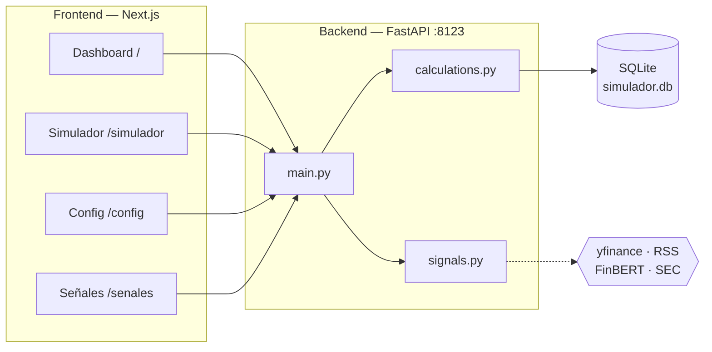
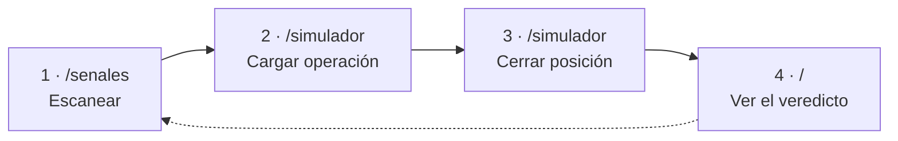
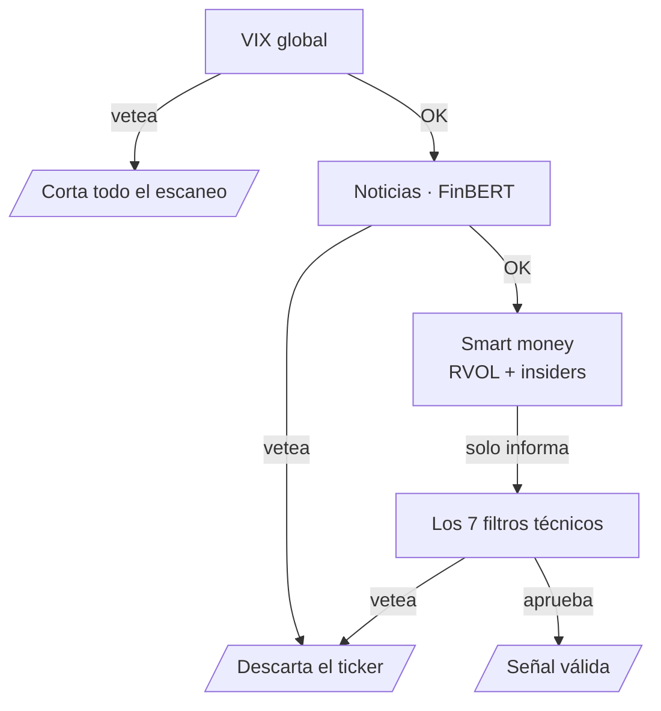

# Simulador de Inversiones IA — Paper Trading

Digitaliza el `Simulador_Inversiones_IA_Paper_Trading.xlsx` original como una
app web: cargás cada señal (real o sugerida por un futuro bot), el sistema
calcula automáticamente comisiones, resultado neto y rendimiento %, y un
dashboard te dice si la estrategia da plata de verdad — antes de arriesgar
un peso.

Es el MVP de un proyecto más grande (ver "Roadmap" abajo): la idea final,
según los manuales que armó tu amigo, es un bot que analiza CEDEARs y bonos
argentinos con filtros técnicos + noticias (FinBERT) + circuit breaker de
VIX, y ejecuta órdenes automáticamente en InvertirOnline (IOL). Este MVP
resuelve el primer paso que los mismos manuales recomiendan: **validar la
estrategia en papel antes de conectar plata real.**

## Estructura del proyecto

```
simulador-inversiones/
├── backend/          FastAPI + SQLite. Toda la lógica de comisiones vive en
│                      app/calculations.py (fórmulas idénticas al Excel).
│                      Encima se apoya el motor de señales: config.py,
│                      market_data.py, technical_filters.py, risk_filters.py,
│                      smart_money.py, fixed_income_filters.py, signals.py.
├── frontend/          Next.js + Tailwind. Dashboard, Simulador, Señales,
│                      Configuración.
└── docs/              Manuales originales (.docx), su texto plano en
                        specs-txt/ y parametros-riesgo.md.
```

### Arquitectura



> [!note] Dónde está el resto de la documentación
> El plan de trabajo fase por fase está en `tareasdesarrollo.md`, y el historial
> de lo ya resuelto en `PROGRESS.md`. Las convenciones del repo, en `CLAUDE.md`.

## Cómo correrlo

### 1. Backend

```bash
cd backend
python3 -m venv venv
source venv/bin/activate        # en Windows: venv\Scripts\activate
pip install -r requirements.txt
python seed.py                  # carga las 5 operaciones de ejemplo del Excel
uvicorn app.main:app --reload --port 8123
```

La API queda en `http://localhost:8123` (documentación interactiva en
`http://localhost:8123/docs`).

> [!warning] FinBERT es pesado
> `requirements.txt` incluye `torch` y `transformers`: son ~2,5 GB instalados y
> necesitan ~1 GB de RAM libre para inferencia. En un servidor chico, comentá
> esas dos líneas — `app/risk_filters.py` está escrito para funcionar sin ellas,
> salteando el filtro de sentimiento.

### 2. Frontend

En otra terminal:

```bash
cd frontend
npm install
npm run dev
```

Abrí `http://localhost:3000`. Si el backend corre en otro puerto/host, editá
`frontend/.env.local` (`NEXT_PUBLIC_API_URL`).

### Variables de entorno

Copiá `backend/.env.example` a `backend/.env` y completá lo que necesites.
Ninguna credencial va hardcodeada ni versionada: `.env` está en `.gitignore`,
y `app/config.py` es el único módulo que las lee.

| Variable | Para qué | Obligatoria |
|---|---|---|
| `IOL_USERNAME` / `IOL_PASSWORD` | API de InvertirOnline | Solo desde la Fase 8 |
| `TELEGRAM_BOT_TOKEN` / `TELEGRAM_CHAT_ID` | Alertas | Solo desde la Fase 7 |
| `GOOGLE_CREDENTIALS_PATH` | Ruta a `credenciales_google.json` | Solo con Sheets (Fase 6) |
| `CAPITAL_TOTAL`, `MAX_POSICIONES`, `MONTO_POR_POSICION` | Pisan los defaults de `config.py` | No |
| `EJECUCION_REAL_HABILITADA` | Kill switch. En `false` (default) nunca sale una orden real | No |

> [!note] Arranca sin credenciales
> Sin ninguna de estas variables el proyecto funciona igual: el simulador y el
> motor de señales no necesitan credenciales.

### Tests

```bash
cd backend
./venv/Scripts/python.exe -m pytest -v          # Windows
# pytest -v                                      # Linux/Mac con el venv activado

pytest -m "not network"    # sin pegarle a Yahoo Finance / SEC / Google News
```

## Cómo se usa: el flujo de trabajo

La app tiene cuatro páginas y el uso diario es siempre el mismo ciclo de cuatro
pasos. Nada de esto toca dinero real (ver "Notas de seguridad" al final).



### 1. Señales (`/senales`) — qué comprar

Tocás **"Volver a escanear"** y esperás. Tarda unos **45 segundos**: el backend
recorre los 10 CEDEARs de `TICKERS_BYMA` y por cada uno evalúa, en este orden:



Devuelve dos tablas:

| Tabla | Qué trae | Para qué sirve |
|---|---|---|
| **Señales válidas** | Precio sugerido, stop-loss, take-profit, % de riesgo. Al lado, como contexto: RVOL, filings de insiders y score de noticias. | Lo que el sistema propone operar. |
| **Descartados** | Cada instrumento vetado **con su motivo** (`VETO RS: no supera a SPY`, `VETO TÉCNICO: estructura no alcista`, etc.). | Es la que más enseña: ahí se ve por qué el sistema no quiso operar algo. |

> [!warning] El contexto no es un filtro aprobado
> RVOL, insiders y score de noticias **no hacen mejor ni peor a una señal**: son
> información de color, no una validación adicional.

Arriba de todo se muestra el estado del VIX. Si el circuit breaker se activa
(VIX > 25 o salto de +10% en el día), **no vas a ver ninguna señal** y aparece un
cartel rojo con el motivo. No es un error: es el sistema negándose a operar en
pánico de mercado.


### 2. Cargar en el simulador — registrar la apuesta

En cada señal válida hay un botón **"Cargar en el simulador"**. Te lleva a
`/simulador` con el formulario abierto y el ticker, el precio y el motivo ya
completos.

> [!note] Decisión de diseño
> **No crea la operación solo.** Completás la cantidad y confirmás vos. Es a
> propósito: el sistema sugiere, la persona decide.

También podés cargar una operación a mano con **"+ Nueva operación"**. Ahí el
botón **"Usar precio de mercado"** trae el último cierre real del ticker, así no
hay que tipearlo.

### 3. Cerrar la posición — registrar el resultado

Cuando la operación termina, en `/simulador` tocás **"Cerrar"** en esa fila y
cargás fecha y precio de salida. Recién ahí el sistema calcula las comisiones de
ida y vuelta y el resultado neto real.

### 4. Dashboard (`/`) — ¿esto rinde o no?

Capital invertido, comisiones pagadas, ganancia/pérdida neta, rentabilidad
ponderada, ganadoras vs. perdedoras y tasa de acierto.


> [!warning] El veredicto es más optimista de lo que parece
> El cartel **"SISTEMA RENTABLE - LISTO PARA REAL"** se enciende con la sola
> condición de que la ganancia neta sea mayor a cero: **una única operación
> cerrada con +$50 ya lo dispara.** No es una luz verde.
>
> El criterio correcto es el de la Tarea 10.4 de `tareasdesarrollo.md`: dejar el
> sistema corriendo **3 o 4 semanas**, cargar cada señal y seguirla hasta el
> cierre, y recién ahí mirar el número. Con 2 operaciones el cartel no significa
> nada.

### Configuración (`/config`)

Ajusta las comisiones del broker (0,5% / 0,08% / 21% por defecto → 0,7018% por
tramo). Cambiarlas **recalcula todo el histórico al instante**, porque los campos
calculados no se guardan en la base: se derivan al vuelo desde `calculations.py`.

### Qué NO hace la app todavía

| No hace | Por qué | Se desbloquea con |
|---|---|---|
| Ver tu saldo real de IOL | Faltan credenciales de API | Tarea 0.2 👤 |
| Ejecutar órdenes | Fase 11, deliberadamente no construida | Validación previa (Tarea 10.4) |
| Avisarte por Telegram | Falta el token del bot | Tarea 0.3 👤 |
| Señales de bonos | El motor de filtros ya existe, falta de dónde sacar el precio | Tarea 0.2 👤 (IOL) |
| Escanear solo, sin abrir la app | Fase 10 | Telegram + VPS |

Hoy es **100% papel**: vos cargás, vos cerrás, el sistema calcula y opina.

## Qué valida este MVP

Las 5 operaciones de ejemplo (AAPL, NVDA, NXE, MELI, TSLA) son las mismas
del Excel original. Los cálculos del backend fueron verificados contra las
fórmulas de la planilla:

| Concepto | Valor | Qué significa |
|---|---|---|
| Comisión por tramo | **0,7018%** | `(comisión broker + derechos de mercado) × (1 + IVA)` con los valores estándar de IOL/BYMA. |
| Costo ida y vuelta | **1,4036%** | El rendimiento bruto mínimo que necesita una operación para no perder plata. |

> [!note] El caso MELI es un ejemplo intencional
> Gana bruto (+1,04%) pero **pierde neto** una vez descontadas las comisiones —
> justo lo que este simulador existe para detectar antes de operar con dinero
> real.

## Roadmap (según los manuales originales)

El plan detallado, tarea por tarea, está en `tareasdesarrollo.md`; lo ya resuelto,
con la evidencia de cómo se probó, en `PROGRESS.md`.

| # | Etapa | Estado | Detalle |
|---|---|---|---|
| 1 | **Paper trading manual** | ✅ | Cargar señales a mano y auditar si conviene seguir. |
| 2 | **Precios reales y señales técnicas** | ✅ | `yfinance` para autocompletar el precio, más los 7 filtros de los manuales (tendencia, ATR, fuerza relativa vs. SPY, earnings). Sin ejecutar nada. |
| 3 | **Filtro de noticias y riesgo** | ✅ | Circuit breaker de VIX + FinBERT local, como capa de veto antes de sugerir una compra. |
| 4 | **Conectar IOL en modo lectura** | ⏳ | Saldo y tenencia real de la cuenta comitente. **Bloqueado:** faltan las credenciales de API de IOL, que se piden desde la configuración de la cuenta. |
| 5 | **Alertas y escaneo 24/7** | ⏳ | Telegram + un job que escanee solo, sin que nadie abra la app. **Bloqueado:** falta el token del bot de Telegram. Es la credencial más fácil de obtener y la que más desbloquea. |
| 6 | **Ejecución automática de órdenes** | ⛔ | Recién después de varias semanas de paper trading con esperanza matemática positiva. Implica manejar plata real: logs auditables y límites de riesgo estrictos (stop-loss, tamaño de posición) desde el día uno. |


> [!note] Frenar en el punto 4 es una opción razonable
> Señales y datos reales con ejecución 100% manual es mucho más simple de
> mantener y ya cubre lo que el sistema promete.

## Notas de seguridad

> [!warning] Hoy el sistema no ejecuta ninguna orden real
> No se conecta a ninguna cuenta de broker. Solo registra operaciones cargadas a
> mano y sugiere señales de lectura.

Lo que ya está puesto para cuando eso cambie:

| Salvaguarda | Cómo funciona |
|---|---|
| Credenciales fuera del repo | Van en variables de entorno (`backend/.env`), nunca hardcodeadas ni versionadas. `.env` está en `.gitignore` y `app/config.py` es el único módulo que las lee. |
| Kill switch | `EJECUCION_REAL_HABILITADA` está en `false` por defecto. Mientras siga así, ningún código puede enviar una orden a IOL. |
| Parámetros centralizados | Los parámetros de riesgo viven en `app/config.py` y están documentados en `docs/parametros-riesgo.md`. Ningún módulo hardcodea capital, stop-loss ni tamaño de posición. |

> [!warning] `docs/parametros-riesgo.md` está marcado como PROVISORIO
> Tiene los valores por defecto de los manuales ($100.000 ARS, 2 posiciones,
> stop-loss 3%, R/B 1:2), **no valores acordados con el dueño del capital**. Hay
> que revisarlos y firmarlos (Tarea 0.1) antes de habilitar cualquier ejecución
> real.
>
> Un detalle concreto a revisar ahí: el stop se recorta al 3,0% únicamente si el
> riesgo calculado por ATR supera el **3,5%**, así que el riesgo real por
> operación puede llegar hasta 3,5% pese a que el parámetro diga 3,0%.
