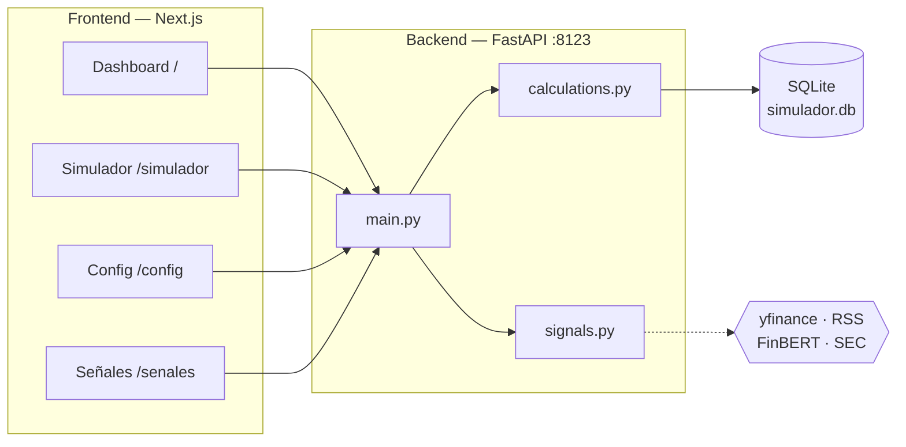
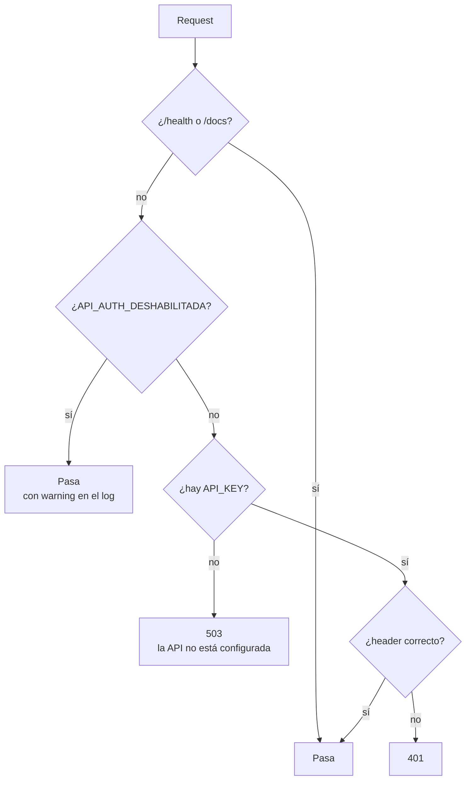
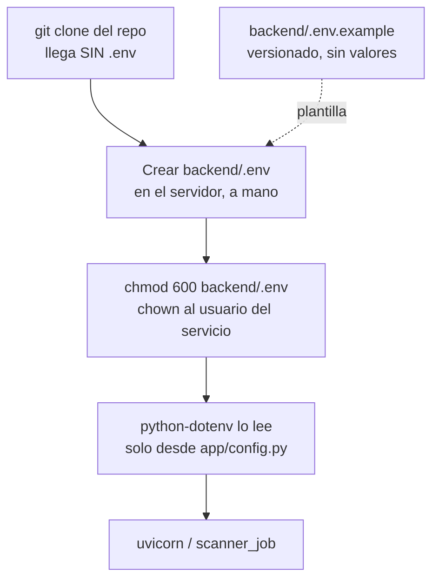
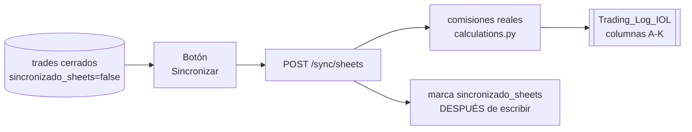
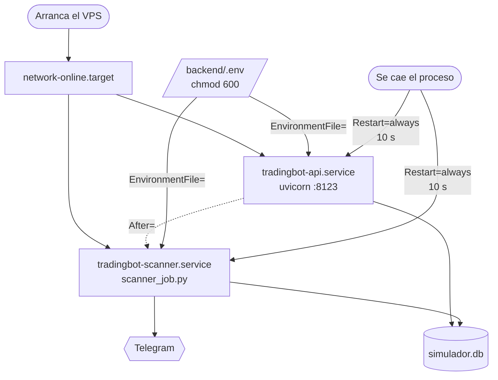
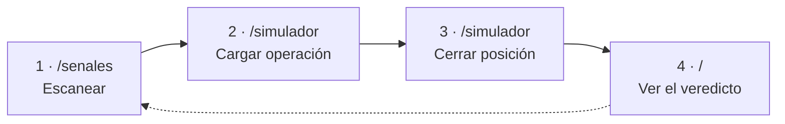
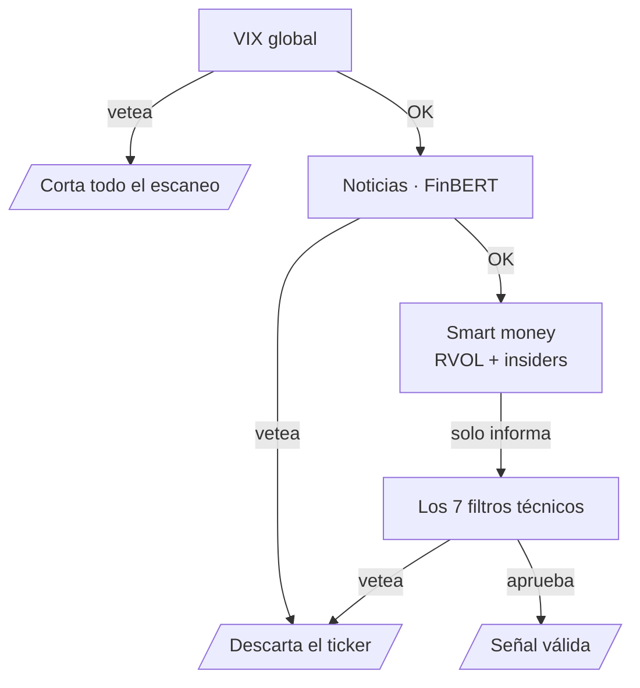
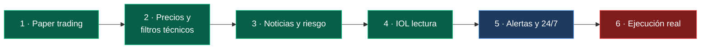

# Simulador de Inversiones IA — Paper Trading

Digitaliza el `Simulador_Inversiones_IA_Paper_Trading.xlsx` original como una
app web: cargás cada señal (real o sugerida por un futuro bot), el sistema
calcula automáticamente comisiones, resultado neto y rendimiento %, y un
dashboard te dice si la estrategia da plata de verdad — antes de arriesgar
un peso.

Es el MVP de un proyecto más grande (ver "Roadmap" abajo): la idea final,
según los manuales que armó tu amigo, es un bot que analiza CEDEARs y bonos
argentinos con filtros técnicos + noticias (FinBERT) + circuit breaker de
VIX, y ejecuta órdenes automáticamente en InvertirOnline (IOL). Este MVP
resuelve el primer paso que los mismos manuales recomiendan: **validar la
estrategia en papel antes de conectar plata real.**

## Estructura del proyecto

```
simulador-inversiones/
├── backend/          FastAPI + SQLite. Toda la lógica de comisiones vive en
│                      app/calculations.py (fórmulas idénticas al Excel).
│                      Encima se apoya el motor de señales: config.py,
│                      market_data.py, technical_filters.py, risk_filters.py,
│                      smart_money.py, fixed_income_filters.py, signals.py,
│                      rsi_signal.py (fuente de señal alternativa),
│                      edgar_13f.py + wallstreet_tracker.py (consenso 13F).
│                      Alertas y automatización: app/notifications.py,
│                      app/weekly_report.py, scanner_job.py,
│                      position_monitor_job.py.
├── frontend/          Next.js + Tailwind. Dashboard, Simulador, Señales,
│                      Configuración.
├── deploy/            Units systemd (tradingbot-api, tradingbot-scanner)
│                      para que el bot corra 24/7 en el VPS.
└── docs/              Manuales originales (.docx), su texto plano en
                        specs-txt/ y parametros-riesgo.md.
```

### Arquitectura



> [!note] Dónde está el resto de la documentación
> El plan de trabajo fase por fase está en `tareasdesarrollo.md`, y el historial
> de lo ya resuelto en `PROGRESS.md`. Las convenciones del repo, en `CLAUDE.md`.

## Cómo correrlo

### 1. Backend

```bash
cd backend
python3 -m venv venv
source venv/bin/activate        # en Windows: venv\Scripts\activate
pip install -r requirements.txt
python seed.py                  # carga las 5 operaciones de ejemplo del Excel
uvicorn app.main:app --reload --port 8123
```

La API queda en `http://localhost:8123` (documentación interactiva en
`http://localhost:8123/docs`).

> [!warning] FinBERT es pesado
> `requirements.txt` incluye `torch` y `transformers`: son ~2,5 GB instalados y
> necesitan ~1 GB de RAM libre para inferencia. En un servidor chico, comentá
> esas dos líneas — `app/risk_filters.py` está escrito para funcionar sin ellas,
> salteando el filtro de sentimiento.

### 2. Alertas y escaneo automático (opcional)

Con `TELEGRAM_BOT_TOKEN` y `TELEGRAM_CHAT_ID` cargados en `backend/.env`, el
sistema puede avisarte solo. Nada de esto ejecuta órdenes: solo notifica.

```bash
cd backend

# Probar que el bot llega a tu chat
curl -X POST http://localhost:8123/notificaciones/test

# Escaneo periódico + monitor de posiciones (Fase 10). Corre en primer plano.
./venv/Scripts/python.exe scanner_job.py

# Un solo ciclo, forzando el chequeo de horario a "siempre activo"
./venv/Scripts/python.exe scanner_job.py --una-vez --ignorar-horario

# Mandar el reporte semanal ahora mismo, sin esperar al viernes
./venv/Scripts/python.exe scanner_job.py --reporte-semanal
```

| Qué avisa | Cuándo | Tarea |
|---|---|---|
| Cierre de una operación | Al hacer `POST /trades/{id}/cerrar` desde la app | 7.2 |
| Venta del gestor de salidas (TP1, trailing, cierre 16:50) | En cada barrido del monitor de posiciones | 7.2 |
| Señal nueva | Cada 10 min en rueda BYMA, una vez por ticker y por día | 10.1 |
| Escaneo bloqueado (VIX en pánico o mercado bajista) | Una vez por día | 10.1 |
| Resumen de la semana | Viernes 17:30, hora del servidor | 12.2 |

> [!warning] El planificador usa el reloj del sistema
> El horario de rueda se chequea en ART, pero el `viernes 17:30` del reporte
> semanal es hora local del servidor. Dejá el servidor en
> `America/Argentina/Buenos_Aires` (es lo que pide la Tarea 10.2) para que las
> dos cosas coincidan.

### 3. Frontend

En otra terminal:

```bash
cd frontend
npm install
npm run dev
```

Abrí `http://localhost:3000`. Si el backend corre en otro puerto/host, editá
`frontend/.env.local` (`NEXT_PUBLIC_API_URL`).

### Variables de entorno

Copiá `backend/.env.example` a `backend/.env` y completá lo que necesites.
Ninguna credencial va hardcodeada ni versionada: `.env` está en `.gitignore`,
y `app/config.py` es el único módulo que las lee.

| Variable | Para qué | Obligatoria | Es secreto |
|---|---|---|---|
| `IOL_USERNAME` | Usuario de InvertirOnline. Lo usa `app/broker_iol.py` para el OAuth2 contra `/token` | Para todo `/iol/*` y `/mercado/ccl` (Fase 8) | Sí |
| `IOL_PASSWORD` | Contraseña de InvertirOnline | Para todo `/iol/*` y `/mercado/ccl` (Fase 8) | **Sí — es la contraseña de la cuenta real** |
| `IOL_API_URL` | Base de la API de IOL. Default `https://api.invertironline.com` | No | No |
| `TELEGRAM_BOT_TOKEN` | Token del bot. **Viaja dentro de la URL** que se le pega a Telegram | Solo para las alertas (Fases 7, 10 y 12) | Sí |
| `TELEGRAM_CHAT_ID` | Chat de destino de las alertas | Solo para las alertas | Identifica el destino |
| `CAPITAL_TOTAL`, `MAX_POSICIONES`, `CUPO_SWING`, `CUPO_SMART_MONEY`, `LIMITE_POR_OPERACION` | Pisan los defaults de `config.py` | No | No |
| `SEC_USER_AGENT` | Dato de contacto que exige la API de SEC EDGAR (consenso 13F). No es una credencial | No | No |
| `MODO_FANTASMA` | Kill switch. En `true` (default) nunca sale una orden real | No | No |

> [!note] Arranca sin credenciales
> Sin ninguna de estas variables el proyecto funciona igual: el simulador y el
> motor de señales no necesitan credenciales. Lo único que se cae sin
> `IOL_USERNAME`/`IOL_PASSWORD` son los endpoints `/iol/saldo` y `/mercado/ccl`,
> que devuelven un `503` con el motivo en castellano.

### Autenticación de la API

Todas las rutas piden el header `X-API-Key`, salvo `/health` y la documentación.

```bash
curl -H "X-API-Key: $API_KEY" http://127.0.0.1:8123/dashboard
```



Configuración:

```bash
# 1. Generar una clave.
python -c "import secrets; print(secrets.token_urlsafe(32))"

# 2. backend/.env
API_KEY=<la clave generada>

# 3. frontend/.env.local — tiene que ser la MISMA.
NEXT_PUBLIC_API_KEY=<la clave generada>

# 4. Comprobar (no pide clave, y dice en qué modo quedó).
curl -s http://127.0.0.1:8123/health
# {"status":"ok","auth":{"activa":true,"motivo":""}}
```

> [!warning] Falla cerrada: sin `API_KEY` la API no atiende
> Responde **503** a todo salvo `/health`. Es deliberado: si el default fuera
> "dejar pasar", un `.env` mal copiado dejaría la API abierta sin que nadie se
> entere. Para correr sin auth hay que pedirlo a mano con
> `API_AUTH_DESHABILITADA=true`, y solo tiene sentido en loopback.

> [!note] `/health` queda público a propósito
> Para que un monitor externo o `systemd` puedan sondear el servicio sin que haya
> que repartirles la credencial. No revela nada: estado y si la auth está activa,
> nunca la clave.

> [!warning] `NEXT_PUBLIC_API_KEY` es visible en el navegador
> Next incrusta toda variable `NEXT_PUBLIC_` en el bundle: cualquiera que abra
> devtools la ve. Es aceptable mientras el frontend corra en tu propia máquina
> contra un backend en loopback, que es el caso hoy. **Si este frontend algún día
> se publica en Vercel, esa clave deja de ser un secreto** y hace falta otra cosa
> — un backend-for-frontend que la guarde del lado del servidor, o login de
> usuario con sesión.

> [!note] Qué NO resuelve esto
> La clave viaja en texto plano si no hay HTTPS. Es suficiente en loopback o por
> túnel SSH; para exponer la API a internet hace falta TLS por delante.

### Cargar las credenciales al desplegar (VPS)

El `.env` **no se commitea nunca** — está en `.gitignore` y `git ls-files
backend/.env` tiene que salir vacío. Al desplegar se crea a mano en el servidor:
no se copia desde la máquina de desarrollo por un canal que quede registrado
(nada de pegarlo en un chat, en un issue o en el historial de un shell
compartido).



Paso a paso en el VPS:

```bash
# 1. Clonar. El repo NO trae el .env: no existe del lado del servidor todavía.
git clone <repo> simuladorinversiones && cd simuladorinversiones/backend

# 2. Partir de la plantilla versionada, que viene con las claves vacías.
cp .env.example .env

# 3. Completar los valores con un editor local al servidor (nunca por copiar y
#    pegar en un canal que quede grabado).
nano .env      # IOL_USERNAME, IOL_PASSWORD, TELEGRAM_BOT_TOKEN, TELEGRAM_CHAT_ID

# 4. Dejarlo legible SOLO por el usuario que corre el bot.
chmod 600 .env
chown "$USER":"$USER" .env

# 5. Verificar que git no lo ve. Las dos salidas tienen que estar vacías.
git ls-files .env
git status --porcelain | grep '\.env$'

# 6. Comprobar que las credenciales entraron bien, sin imprimirlas.
./venv/bin/python -c "from app import config; print('IOL:', bool(config.IOL_USERNAME and config.IOL_PASSWORD)); print('Telegram:', bool(config.TELEGRAM_BOT_TOKEN and config.TELEGRAM_CHAT_ID))"
```

> [!warning] Qué NO hacer en el servidor
> - No pasar las credenciales por línea de comandos (`IOL_PASSWORD=... uvicorn ...`):
>   quedan en `~/.bash_history` y las ve cualquiera con `ps aux`.
> - No pegarlas en un `docker run -e`, un `systemd` `Environment=` ni un
>   `ExecStart` — usar `EnvironmentFile=/ruta/backend/.env` con permisos `600`.
> - No dejar la clave SSH del VPS dentro del repo. `.gitignore` ya bloquea
>   `*.key`, `*.pem`, `id_rsa*` y `ssh-key-*`, pero el lugar correcto es
>   `~/.ssh/` con `chmod 600`.

> [!note] Si una credencial se filtró
> Rotar primero, limpiar después. Cambiar la contraseña en IOL y regenerar el
> token con `@BotFather` es inmediato; reescribir el historial de git no
> "desfiltra" nada que ya se haya publicado.

### Bitácora espejo en Google Sheets (Fase 6, opcional)

Espeja cada operación **cerrada** a la hoja `Trading_Log_IOL`, para poder mirar
los números desde el celular sin abrir la app. La app sigue siendo la fuente de
verdad: la hoja es solo de escritura.

> [!note] Es opcional de verdad
> Sin configurar, el resto del sistema funciona igual. El botón "Sincronizar con
> Sheets" del simulador aparece deshabilitado y explica qué falta.



Pasos:

```bash
# 1. Crear la cuenta de servicio (Tarea 0.4) en console.cloud.google.com:
#    proyecto nuevo -> habilitar "Google Sheets API" y "Google Drive API"
#    -> Credenciales -> Cuenta de servicio -> Claves -> Crear clave JSON.

# 2. Guardar el JSON FUERA del repo y dejarlo legible solo por tu usuario.
mv ~/Descargas/*.json ~/.config/tradingbot/credenciales_google.json
chmod 600 ~/.config/tradingbot/credenciales_google.json

# 3. Apuntar el backend al archivo (en backend/.env).
GOOGLE_CREDENTIALS_PATH=/home/ubuntu/.config/tradingbot/credenciales_google.json
SHEETS_NOMBRE_HOJA=Trading_Log_IOL

# 4. Crear la hoja en Google Sheets con ese nombre exacto y COMPARTIRLA como
#    Editor con el client_email que figura dentro del JSON
#    (ej. sheets-bot@tradingbotlogger.iam.gserviceaccount.com).

# 5. Comprobar que el backend la ve.
curl -s http://127.0.0.1:8123/sync/sheets      # -> {"configurado":true,...}
```

> [!warning] El JSON de la cuenta de servicio es una credencial
> `.gitignore` ya bloquea `credenciales_google.json` y `*credentials*.json`, pero
> el lugar correcto no es el repo. Si se filtra, se revoca la clave desde Google
> Cloud Console (Cuenta de servicio → Claves → borrar) y se genera otra.

> [!note] Las comisiones NO son el 0,6% del manual
> El manual hardcodea 0,6% por tramo; la tasa real del Excel es **0,7018%**
> (0,5% + 0,08%, +21% IVA). La hoja recibe lo que calcula `calculations.py`, con
> las tasas que tengas cargadas en `/config` — así la bitácora nunca contradice al
> dashboard.

### Correr 24/7 en el VPS (systemd)

Los dos servicios viven en [`deploy/`](./deploy) y están pensados para que el
sistema se levante solo después de un corte de luz o un `reboot`.

| Servicio | Qué corre | Reinicio |
|---|---|---|
| `tradingbot-api.service` | `uvicorn app.main:app` en `127.0.0.1:8123` | `always`, `RestartSec=10` |
| `tradingbot-scanner.service` | `scanner_job.py` — escaneo cada 10 min, monitor de posiciones y reporte semanal | `always`, `RestartSec=10` |



#### Antes de instalar

> [!warning] Con menos de 2 GB de RAM hace falta swap — si no, FinBERT mata al scanner
> `transformers` + `torch` pesan ~2,5 GB en disco y FinBERT necesita cerca de 1 GB
> de RAM para inferir. En el VPS de 1 GB donde corre esto hoy, el scanner queda en
> ~460 MB residentes y **usa ~1 GB de swap**: sin swap el kernel lo mata (OOM) a
> mitad de ciclo y systemd lo reinicia en loop. Crear 2 GB de swap **antes** de
> levantar los servicios:
> ```bash
> sudo fallocate -l 2G /swapfile
> sudo chmod 600 /swapfile
> sudo mkswap /swapfile && sudo swapon /swapfile
> # Que sobreviva al reboot:
> echo '/swapfile none swap sw 0 0' | sudo tee -a /etc/fstab
> swapon --show      # tiene que listar /swapfile con 2G
> ```
> La alternativa, si no querés swap, es sacar `transformers` y `torch` de
> `requirements.txt`: `risk_filters.py` degrada solo y sigue aplicando el veto por
> palabras críticas, pero perdés el score de sentimiento (queda en 0.0).

> [!warning] El `.env` tiene que existir en el servidor
> Las dos units usan `EnvironmentFile=`, y systemd **falla el arranque** si el
> archivo no existe. Completar primero los 6 pasos de
> ["Cargar las credenciales al desplegar (VPS)"](#cargar-las-credenciales-al-desplegar-vps).

> [!warning] La API escucha en `127.0.0.1`, no en `0.0.0.0` — a propósito
> La API **ya pide clave** (`X-API-Key`, ver [Autenticación](#autenticación-de-la-api)),
> pero el bind sigue en loopback: son dos capas distintas y conviene tener las dos.
> `/iol/saldo` devuelve el saldo y la tenencia reales de la cuenta comitente, y
> `/trades` permite crear y borrar operaciones.
> Para consumirla desde afuera (por ejemplo un frontend en Vercel) **no alcanza
> con cambiar el bind ni con la API key**: falta un reverse proxy con TLS, porque
> sin HTTPS la clave viaja en texto plano en cada request. Mientras eso no exista,
> lo seguro es un túnel SSH:
> `ssh -L 8123:127.0.0.1:8123 ubuntu@161.153.207.188` y apuntar
> `NEXT_PUBLIC_API_URL` a `http://127.0.0.1:8123` en la máquina local.

#### Instalar y habilitar

Las units vienen con el usuario `tradingbot` y la ruta
`/opt/tradingbot/simuladorinversiones`. Si tu layout es otro, el `sed` del paso 2
reemplaza las dos cosas de una sola vez.

```bash
# 1. Usuario de servicio sin privilegios ni shell de login (si no existe).
sudo useradd --system --create-home --shell /usr/sbin/nologin tradingbot

# 2. Ajustar usuario y ruta si hacen falta. Editar estas dos variables y correr.
USUARIO=tradingbot
RUTA=/opt/tradingbot/simuladorinversiones
sed -i "s|/opt/tradingbot/simuladorinversiones|$RUTA|g; s|^User=.*|User=$USUARIO|; s|^Group=.*|Group=$USUARIO|" deploy/*.service

# 3. Copiar las units y recargar systemd.
sudo cp deploy/tradingbot-api.service deploy/tradingbot-scanner.service /etc/systemd/system/
sudo systemctl daemon-reload

# 4. Habilitar (arrancan solos al bootear) y levantar ahora.
sudo systemctl enable --now tradingbot-api.service tradingbot-scanner.service

# 5. Confirmar que los dos quedaron en "active (running)".
sudo systemctl status tradingbot-api.service tradingbot-scanner.service --no-pager
```

> [!note] El scanner avisa por Telegram cuando arranca
> Si al hacer `enable --now` llega el mensaje *"🟢 Scanner iniciado"* al chat, el
> servicio levantó **y** las credenciales del `.env` entraron bien. Es la
> verificación más rápida de que todo quedó conectado.

#### Operación diaria

```bash
# Ver los logs en vivo (el scanner loguea cada ciclo de escaneo).
sudo journalctl -u tradingbot-scanner.service -f

# Últimas 100 líneas de la API.
sudo journalctl -u tradingbot-api.service -n 100 --no-pager

# Reiniciar después de un `git pull`.
sudo systemctl restart tradingbot-api.service tradingbot-scanner.service

# Parar el escaneo sin desinstalar nada (deja de notificar).
sudo systemctl stop tradingbot-scanner.service

# Probar que sobreviven a un reinicio del servidor (criterio de la Tarea 10.3).
sudo reboot
# ... volver a entrar por SSH y repetir el `systemctl status` del paso 5.
```

> [!warning] Zona horaria: la unit la fija, pero el servidor también tiene que estar en ART
> Las dos units traen `Environment=TZ=America/Argentina/Buenos_Aires` porque
> `schedule` dispara el reporte semanal con el reloj del proceso
> (`friday at 17:30`), no con `TZ_BYMA`. Igual conviene dejar el VPS entero en esa
> zona y con el reloj sincronizado — de eso depende que el cierre preventivo de
> las 16:50 (Tarea 3.5) salte en el momento exacto:
> ```bash
> sudo timedatectl set-timezone America/Argentina/Buenos_Aires
> sudo timedatectl set-ntp true
> timedatectl status        # "System clock synchronized: yes"
> ```

> [!note] Las credenciales no van en la unit
> `systemctl show tradingbot-scanner` imprime todo lo que esté en `Environment=`,
> y eso queda en el journal. Por eso el `.env` entra por `EnvironmentFile=` con
> permisos `600`, y en `Environment=` solo hay `TZ` y `PYTHONUNBUFFERED`.

### Tests

```bash
cd backend
./venv/Scripts/python.exe -m pytest -v          # Windows
# pytest -v                                      # Linux/Mac con el venv activado

pytest -m "not network"    # sin pegarle a Yahoo Finance / SEC / Google News
```

## Endpoints de la API

> [!note] Todas piden `X-API-Key`
> Salvo `/health` y la documentación. Ver [Autenticación](#autenticación-de-la-api).

| Método | Ruta | Qué devuelve |
|---|---|---|
| `GET` | `/health` | Estado del servicio y si la auth está activa (**pública**) |
| `GET` | `/senales` | CEDEARs: 7 filtros técnicos + RSI de sobreventa, cada candidato con su `origen` |
| `GET` | `/senales/bonos` | Renta fija: precio **real en pesos** de BYMA, vía IOL |
| `GET` | `/senales/smart-money` | Consenso institucional 13F de 5 fondos grandes |
| `GET` | `/iol/saldo` | Saldo y tenencia **real** de la cuenta comitente (solo lectura) |
| `GET` | `/mercado/ccl` | Dólar Contado con Liquidación implícito (AL30 / AL30D) |
| `GET` | `/dashboard` | Métricas de paper trading, con desglose por estrategia |
| `GET` | `/riesgo/vix` | Estado del circuit breaker de VIX |
| `POST` | `/notificaciones/test` | Manda un mensaje de prueba a Telegram |
| `GET` | `/sync/sheets` | Si Google Sheets está configurado y cuántas operaciones faltan subir |
| `POST` | `/sync/sheets` | Espeja a `Trading_Log_IOL` las operaciones cerradas pendientes |

> [!warning] Dos fuentes de precio, y no son intercambiables
> `/senales` (CEDEARs) usa **yfinance**, que devuelve la acción subyacente en
> **USD** — sirve para el patrón técnico, no para calcular cantidades. `/senales/bonos`
> y `/iol/saldo` usan **IOL**, que da el precio **real en pesos**. Para la misma
> fecha, AAPL vale US$ 319,97 en yfinance y $ 25.400 como CEDEAR en BYMA.

## Cómo se usa: el flujo de trabajo

La app tiene cuatro páginas y el uso diario es siempre el mismo ciclo de cuatro
pasos. Nada de esto toca dinero real (ver "Notas de seguridad" al final).



### 1. Señales (`/senales`) — qué comprar

Tocás **"Volver a escanear"** y esperás. Tarda unos **45 segundos**: el backend
recorre los 10 CEDEARs de `TICKERS_BYMA` y por cada uno evalúa, en este orden:



Devuelve dos tablas:

| Tabla | Qué trae | Para qué sirve |
|---|---|---|
| **Señales válidas** | Precio sugerido, stop-loss, take-profit, % de riesgo. Al lado, como contexto: RVOL, filings de insiders y score de noticias. | Lo que el sistema propone operar. |
| **Descartados** | Cada instrumento vetado **con su motivo** (`VETO RS: no supera a SPY`, `VETO TÉCNICO: estructura no alcista`, etc.). | Es la que más enseña: ahí se ve por qué el sistema no quiso operar algo. |

> [!warning] El contexto no es un filtro aprobado
> RVOL, insiders y score de noticias **no hacen mejor ni peor a una señal**: son
> información de color, no una validación adicional.

Arriba de todo se muestra el estado del VIX. Si el circuit breaker se activa
(VIX > 25 o salto de +10% en el día), **no vas a ver ninguna señal** y aparece un
cartel rojo con el motivo. No es un error: es el sistema negándose a operar en
pánico de mercado.


### 2. Cargar en el simulador — registrar la apuesta

En cada señal válida hay un botón **"Cargar en el simulador"**. Te lleva a
`/simulador` con el formulario abierto y el ticker, el precio y el motivo ya
completos.

> [!note] Decisión de diseño
> **No crea la operación solo.** Completás la cantidad y confirmás vos. Es a
> propósito: el sistema sugiere, la persona decide.

También podés cargar una operación a mano con **"+ Nueva operación"**. Ahí el
botón **"Usar precio de mercado"** trae el último cierre real del ticker, así no
hay que tipearlo.

### 3. Cerrar la posición — registrar el resultado

Cuando la operación termina, en `/simulador` tocás **"Cerrar"** en esa fila y
cargás fecha y precio de salida. Recién ahí el sistema calcula las comisiones de
ida y vuelta y el resultado neto real.

### 4. Dashboard (`/`) — ¿esto rinde o no?

Capital invertido, comisiones pagadas, ganancia/pérdida neta, rentabilidad
ponderada, ganadoras vs. perdedoras y tasa de acierto.


> [!warning] El veredicto es más optimista de lo que parece
> El cartel **"SISTEMA RENTABLE - LISTO PARA REAL"** se enciende con la sola
> condición de que la ganancia neta sea mayor a cero: **una única operación
> cerrada con +$50 ya lo dispara.** No es una luz verde.
>
> El criterio correcto es el de la Tarea 10.4 de `tareasdesarrollo.md`: dejar el
> sistema corriendo **3 o 4 semanas**, cargar cada señal y seguirla hasta el
> cierre, y recién ahí mirar el número. Con 2 operaciones el cartel no significa
> nada.

### Configuración (`/config`)

Ajusta las comisiones del broker (0,5% / 0,08% / 21% por defecto → 0,7018% por
tramo). Cambiarlas **recalcula todo el histórico al instante**, porque los campos
calculados no se guardan en la base: se derivan al vuelo desde `calculations.py`.

### Qué NO hace la app todavía

| No hace | Por qué | Se desbloquea con |
|---|---|---|
| Ejecutar órdenes | Fase 11, deliberadamente no construida | Validación previa (Tarea 10.4) |
| Correr 24/7 en un servidor | ✅ Hecho — corre en el VPS bajo systemd, verificado tras un reboot | — |

Hoy es **100% papel**: vos cargás, vos cerrás, el sistema calcula y opina.

## Qué valida este MVP

Las 5 operaciones de ejemplo (AAPL, NVDA, NXE, MELI, TSLA) son las mismas
del Excel original. Los cálculos del backend fueron verificados contra las
fórmulas de la planilla:

| Concepto | Valor | Qué significa |
|---|---|---|
| Comisión por tramo | **0,7018%** | `(comisión broker + derechos de mercado) × (1 + IVA)` con los valores estándar de IOL/BYMA. |
| Costo ida y vuelta | **1,4036%** | El rendimiento bruto mínimo que necesita una operación para no perder plata. |

> [!note] El caso MELI es un ejemplo intencional
> Gana bruto (+1,04%) pero **pierde neto** una vez descontadas las comisiones —
> justo lo que este simulador existe para detectar antes de operar con dinero
> real.

## Roadmap (según los manuales originales)

El plan detallado, tarea por tarea, está en `tareasdesarrollo.md`; lo ya resuelto,
con la evidencia de cómo se probó, en `PROGRESS.md`.

| # | Etapa | Estado | Detalle |
|---|---|---|---|
| 1 | **Paper trading manual** | ✅ | Cargar señales a mano y auditar si conviene seguir. |
| 2 | **Precios reales y señales técnicas** | ✅ | `yfinance` para autocompletar el precio, más los 7 filtros de los manuales (tendencia, ATR, fuerza relativa vs. SPY, earnings). Sin ejecutar nada. |
| 3 | **Filtro de noticias y riesgo** | ✅ | Circuit breaker de VIX + FinBERT local, como capa de veto antes de sugerir una compra. |
| 3b | **Consenso institucional (13F)** | ✅ | Segunda estrategia, independiente del swing técnico y con su propio cupo de capital: sigue qué compraron 5 fondos grandes en SEC EDGAR y exige que coincidan al menos dos. |
| 4 | **Conectar IOL en modo lectura** | ✅ | Saldo y tenencia real de la cuenta comitente, dólar CCL y cotizaciones reales en pesos de BYMA. El login contra IOL está verificado. Habilitó además las señales de bonos (9.4), que necesitaban precio en Contado Inmediato. |
| 5 | **Alertas y escaneo 24/7** | ✅ | Telegram avisa cierres, señales nuevas y el reporte semanal. `scanner_job.py` corre **24/7 en el VPS** bajo systemd ([cómo instalarlo](#correr-247-en-el-vps-systemd)), verificado tras un reinicio real del servidor. Lo que sigue no es código: el período de validación de 3-4 semanas (Tarea 10.4 👤). |
| 5b | **Bitácora en Google Sheets** | 🟡 | Opcional. Las operaciones cerradas se espejan a la hoja `Trading_Log_IOL` con un botón en el simulador, para mirarlas desde el celular. Código listo y probado; **falta** la cuenta de servicio de Google (Tarea 0.4 👤) para hacer la primera sincronización real. |
| 6 | **Ejecución automática de órdenes** | ⛔ | Recién después de varias semanas de paper trading con esperanza matemática positiva. Implica manejar plata real: logs auditables y límites de riesgo estrictos (stop-loss, tamaño de posición) desde el día uno. |



> [!note] Frenar en el punto 4 es una opción razonable
> Señales y datos reales con ejecución 100% manual es mucho más simple de
> mantener y ya cubre lo que el sistema promete.

## Notas de seguridad

> [!warning] Hoy el sistema no ejecuta ninguna orden real
> No se conecta a ninguna cuenta de broker. Solo registra operaciones cargadas a
> mano y sugiere señales de lectura.

Lo que ya está puesto para cuando eso cambie:

| Salvaguarda | Cómo funciona |
|---|---|
| Credenciales fuera del repo | Van en variables de entorno (`backend/.env`), nunca hardcodeadas ni versionadas. `.env` está en `.gitignore` y `app/config.py` es el único módulo que las lee. Cómo cargarlas en un servidor: ["Cargar las credenciales al desplegar (VPS)"](#cargar-las-credenciales-al-desplegar-vps). |
| Claves privadas bloqueadas por patrón | `.gitignore` ignora `*.key`, `*.pem`, `*.p12`, `id_rsa*`, `id_ed25519*` y `ssh-key-*`. Una clave privada commiteada es prácticamente imposible de sacar del historial después, así que se bloquea por forma y no por nombre puntual (Tarea 8.3). |
| Ningún secreto en logs ni en respuestas | `broker_iol.py` nunca loguea el token ni la contraseña — el usuario sale ofuscado (`ul***@...`) y su `__repr__` solo dice "autenticado / sin token". `notifications.py` redacta el `TELEGRAM_BOT_TOKEN` de todo texto derivado de una excepción o de un cuerpo de error, porque la API de Telegram lleva el token **dentro de la URL** y `requests` la incluye entera en sus errores de red (Tarea 8.3). |
| Kill switch | `MODO_FANTASMA` está en `true` por defecto. Mientras siga así, ningún código puede enviar una orden a IOL. (Reemplaza a la vieja `EJECUCION_REAL_HABILITADA`, que ya no se lee: si quedó en un `.env`, `config.py` avisa por consola.) |
| Parámetros centralizados | Los parámetros de riesgo viven en `app/config.py` y están documentados en `docs/parametros-riesgo.md`. Ningún módulo hardcodea capital, stop-loss ni tamaño de posición. |

Chequeo rápido de que nada se filtró, corriendo desde la raíz del repo:

```bash
git ls-files backend/.env                      # tiene que salir vacío
git log --all -p | grep -i "iol_password"      # solo placeholders de los manuales
git check-ignore -v ssh-key-*.key              # tiene que decir IGNORADO
```

> [!warning] `docs/parametros-riesgo.md` está marcado como PROVISORIO
> Tiene los valores por defecto de los manuales ($100.000 ARS, 2 posiciones,
> stop-loss 3%, R/B 1:2), **no valores acordados con el dueño del capital**. Hay
> que revisarlos y firmarlos (Tarea 0.1) antes de habilitar cualquier ejecución
> real.
>
> Un detalle concreto a revisar ahí: el stop se recorta al 3,0% únicamente si el
> riesgo calculado por ATR supera el **3,5%**, así que el riesgo real por
> operación puede llegar hasta 3,5% pese a que el parámetro diga 3,0%.
