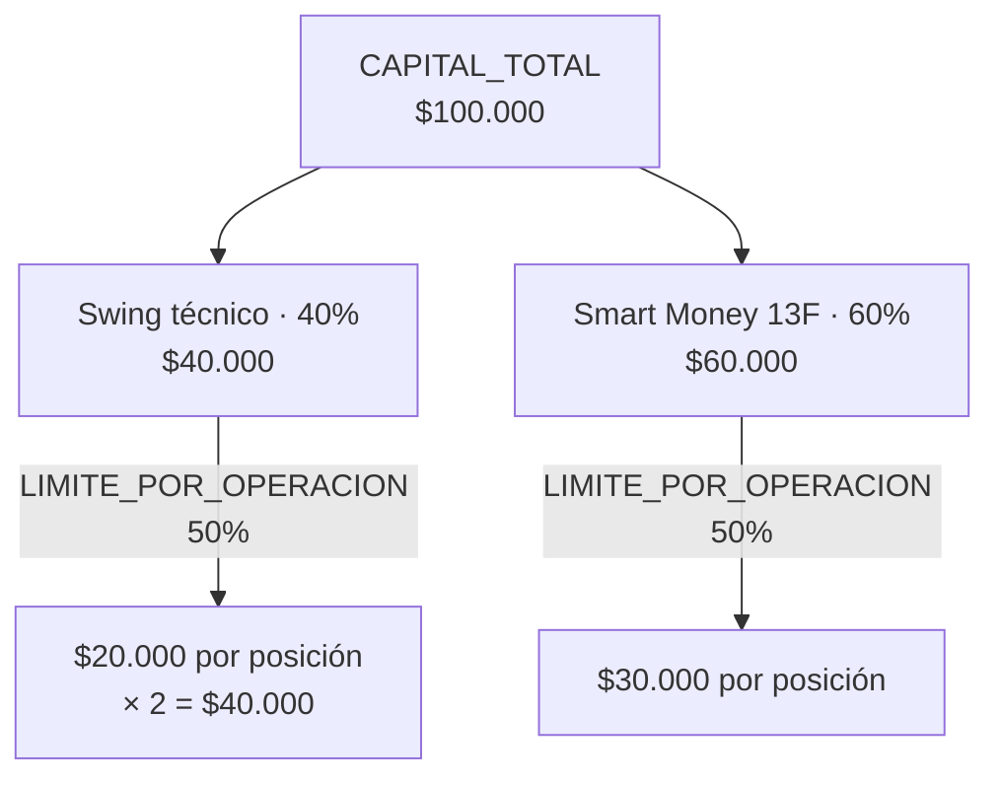

# Parámetros de riesgo del sistema

> [!done] ESTADO: Tarea 0.1 resuelta — 2026-09-06
> El capital, los cupos por estrategia y el límite por operación están decididos
> (ver "Capital y tamaño de posición"). El resto de los valores sigue siendo el
> que traen los manuales originales
> (`Manual_Maestro_Bot_Inversion_IA_Completo.docx`, sección 3, y
> `Manual_Maestro_Bot_Bonos_Soberanos_Provinciales.docx`, sección 3).
>
> Este archivo es la fuente de verdad: si cambia un número acá, tiene que cambiar
> en `backend/app/config.py`, y al revés.

## Cómo se aplican al evaluar una señal

## Capital y tamaño de posición

| Parámetro | Valor | Significado |
|---|---|---|
| `CAPITAL_TOTAL` | `100_000.0` ARS | Capital total asignado al sistema. |
| `MAX_POSICIONES` | `2` | Posiciones abiertas simultáneas como máximo. |
| `CUPO_SWING` | `0.40` (40%) | Porción del capital para la estrategia de swing técnico (Fases 3-4). |
| `CUPO_SMART_MONEY` | `0.60` (60%) | Porción para la estrategia de consenso institucional 13F (Tarea 5.5). |
| `LIMITE_POR_OPERACION` | `0.50` (50%) | Máximo de **el cupo de su estrategia** que puede ir a un solo activo. |
| `SALDO_MINIMO_OPERAR` | `10_000.0` ARS | Piso de saldo disponible por debajo del cual no se abren posiciones nuevas (lo usa la Tarea 11.2). |

### Cómo se reparte el capital

> [!warning] El límite se aplica sobre el cupo, no sobre el capital total
> La Tarea 0.1 del plan sugiere un máximo de 15-20% (manuales) o 10% (Gemini) del
> capital **total** en un solo activo. Acá se decidió mantener el 50% que ya
> estaba, que queda por encima de ese rango: **es una excepción consciente**.
>
> Para que ese 50% conviva con los cupos hay que aplicarlo sobre el cupo de cada
> estrategia. Si se aplicara sobre el capital total, una sola posición de swing
> serían $50.000 contra un cupo de $40.000 — aritméticamente imposible.
>
> Consecuencia práctica: la exposición máxima real por posición es 20% del
> capital total en swing y 30% en smart money, no 50%.

> [!note] `MONTO_POR_POSICION` quedó como alias
> Sigue existiendo por compatibilidad y hoy vale `monto_por_posicion("SWING")`.
> Para cualquier cálculo nuevo usar `config.monto_por_posicion(estrategia)`.

## Gestión de riesgo por operación

| Parámetro | Valor | Significado |
|---|---|---|
| `STOP_LOSS_MAX_PCT` | `0.030` (3,0%) | Pérdida máxima estricta por operación. El stop dinámico por ATR (1,5 × ATR) nunca puede quedar más lejos que esto. |
| `STOP_LOSS_TOLERANCIA_PCT` | `0.035` (3,5%) | Umbral por encima del cual el stop calculado por ATR se recorta a `STOP_LOSS_MAX_PCT`. Es el `if pct_riesgo > 0.035` del manual (sección 6). |
| `ATR_MULTIPLICADOR` | `1.5` | Multiplicador del ATR(14) para ubicar el stop-loss. |
| `TAKE_PROFIT_RATIO` | `2.0` | Ratio riesgo/beneficio mínimo exigido: 1:2. |

> [!warning] El tope efectivo es 3,5%, no 3,0%
> `STOP_LOSS_MAX_PCT` solo se aplica **si el riesgo calculado supera
> `STOP_LOSS_TOLERANCIA_PCT`**. Una operación con riesgo de 3,27% queda tal cual,
> por encima del 3,0% nominal (se observó en AMZN durante la Tarea 3.2). Es el
> comportamiento del manual, replicado a propósito — pero conviene decidirlo
> explícitamente al confirmar la Tarea 0.1.

## Umbrales de veto por riesgo de mercado

| Parámetro | Valor | Significado |
|---|---|---|
| `VIX_NIVEL_PANICO` | `25.0` | Por encima de este nivel del VIX no se autorizan compras. |
| `VIX_SUBA_DIARIA_MAX` | `0.10` (10%) | Suba intradiaria del VIX que dispara el circuit breaker. |
| `SENTIMIENTO_MIN_ACCIONES` | `-0.35` | Score FinBERT promedio por debajo del cual se veta una acción/CEDEAR. |
| `SENTIMIENTO_MIN_BONOS` | `-0.30` | Score FinBERT promedio por debajo del cual se veta un bono. |
| `EARNINGS_DIAS_VETO` | `7` | Días antes de un balance en los que no se abre posición. |

## Renta fija (bonos)

| Parámetro | Valor | Significado |
|---|---|---|
| `SPREAD_BID_ASK_MAX` | `0.006` (0,6%) | Spread máximo en Contado Inmediato para considerar líquido un bono. |
| `CUPON_DIA_DESDE` / `CUPON_DIA_HASTA` | `1` / `12` | Ventana del mes de corte en la que no se compra por cupón inminente. |
| `RVOL_ACUMULACION_BONOS` | `1.8` | RVOL a partir del cual se considera acumulación institucional en bonos. |

## Smart money (contexto, no filtro obligatorio)

| Parámetro | Valor | Significado |
|---|---|---|
| `RVOL_ACUMULACION` | `2.0` | RVOL a partir del cual se marca acumulación institucional en acciones. |
| `INSIDERS_MIN_FILINGS` | `2` | Cantidad de filings Form 4 recientes para marcar compras de directores. |

> [!note] Estos dos no vetan
> Se informan como contexto adicional. Un RVOL bajo o la ausencia de filings no
> invalidan una señal.

## Gestión de salidas (Tarea 3.5 — `PositionManager`)

Reemplaza al take-profit fijo R/B 1:2 una vez que la posición ya está abierta.

| Parámetro | Valor | Significado |
|---|---|---|
| `SALIDA_SL_INICIAL_PCT` | `0.030` (-3,0%) | Stop inicial sobre el 100% de la posición. |
| `SALIDA_TP1_PCT` | `0.045` (+4,5%) | Vende el 50% y cancela el stop inicial. |
| `SALIDA_PISO_GARANTIZADO_PCT` | `0.035` (+3,5%) | Piso infranqueable del remanente una vez cobrado el TP1. |
| `SALIDA_TRAILING_PULLBACK` | `0.012` (1,2%) | Retroceso máximo tolerado desde el pico. El stop solo sube. |
| `SALIDA_TP2_PCT` | `0.080` (+8,0%) | Techo: cierra el remanente. |
| `SALIDA_HORA_CIERRE_PREVENTIVO` | `16:50` ART | Si queda posición con TP1 cobrado, se liquida a mercado. Cero riesgo overnight. |
| `SALIDA_SWING_MAX_DIAS` | `10` días corridos | Vencimiento por tiempo (el `SWING_MAX_DIAS` del plan). Si a los 10 días no tocó ni el SL inicial ni el TP1, se cierra igual: no gana ni pierde, pero inmoviliza capital y ocupa un cupo de `MAX_POSICIONES`. Una posición que ya cobró TP1 no vence: la gestiona el trailing. |
| `TZ_BYMA` | `America/Argentina/Buenos_Aires` | Zona horaria de la rueda local. |

> [!note] Por qué el cierre de las 16:50
> Evita el gap bajista nocturno: una caída en Wall Street o una noticia local
> pueden abrir el papel con un hueco negativo a las 11:00 del día siguiente. Se
> prioriza asegurar el profit real en caja.

## Filtros de entrada (Tarea 4.4 — `EntryValidator`)

| Parámetro | Valor | Significado |
|---|---|---|
| `ENTRADA_MAX_CHASE_PCT` | `0.010` (+1,0%) | Tolerancia máxima sobre el nivel de ruptura. Más arriba, la señal se considera vencida. |
| `ENTRADA_MERCADO_CAIDA_MAX` | `-0.010` (-1,0%) | Caída diaria del índice a partir de la cual se bloquean todas las compras. |
| `SMA_BENCHMARK_PERIODO` | `200` | Ruedas de la media móvil diaria del benchmark. |
| `BENCHMARK_POR_TIPO` | CEDEAR→`SPY`, ACCION→`^MERV`, BONO→`None` | Índice de referencia según el instrumento. |

> [!warning] El régimen de mercado vetea ante falta de datos
> Si no se puede traer el benchmark, `chequear_regimen_mercado` **veta**
> (fail-safe), igual que el circuit breaker de VIX: dejar pasar habilitaría el
> universo entero justo el día que Yahoo no responde.

## Señal alternativa por RSI (Tarea 3.7)

Fuente de señal paralela a los 7 filtros, deliberadamente más simple. **Conviven**:
ninguna reemplaza a la otra, y cada candidato de `/senales` sale marcado con su
`origen` (`7_FILTROS`, `RSI` o `AMBOS`) para poder comparar cuál rinde mejor.

| Parámetro | Valor | Significado |
|---|---|---|
| `RSI_PERIODO` | `14` | Períodos del RSI, con suavizado de Wilder. |
| `RSI_SOBREVENTA` | `30.0` | Por debajo de este RSI se considera sobreventa y se dispara la señal. |
| `LIQUIDEZ_SPREAD_MAX` | `0.010` (1,0%) | Spread bid/ask máximo para considerar líquido un CEDEAR. Más amplio que el de bonos porque el mercado es menos profundo. |

> [!warning] El filtro de liquidez todavía no bloquea
> No hay de dónde sacar el libro de órdenes del CEDEAR en BYMA: `yfinance` da la
> acción del subyacente en EE.UU. Sin bid/ask reales, `rsi_signal.chequear_liquidez`
> devuelve "pasa" con `disponible=False`. La lógica está escrita y probada; se
> vuelve bloqueante sola en cuanto `IOLClient` (Fase 8) traiga las puntas.

El stop-loss y el take-profit de una señal de RSI se calculan con **el mismo
criterio que los 7 filtros** (ATR × `ATR_MULTIPLICADOR`, recortado a
`STOP_LOSS_MAX_PCT`, R/B `TAKE_PROFIT_RATIO`): cambia el disparador de la señal,
no la gestión del riesgo.

## Consenso institucional 13F (Tareas 5.3, 5.4 y 5.5)

Estrategia independiente del swing técnico, con su propio cupo de capital. A
diferencia del RVOL y los Form 4 (que son solo contexto), **esta genera y cierra
operaciones por sí sola**.

| Parámetro | Valor | Significado |
|---|---|---|
| `FONDOS_13F` | 5 fondos | CIKs de SEC EDGAR que se siguen: Berkshire, Bridgewater, Renaissance, Tiger Global y Baupost. |
| `SMART_MIN_CONSENSO` | `2` | Fondos distintos que tienen que coincidir para generar una señal de compra. |
| `SMART_MIN_PESO_CARTERA` | `0.01` (1,0%) | Peso mínimo de la posición en la cartera del fondo. Por debajo, es ruido para el fondo. |
| `SMART_MAX_DELAY_SUBA` | `0.10` (+10%) | Si el precio actual ya se despegó más que esto del precio promedio del fondo, la señal llegó tarde. |

> [!warning] Los 13F llegan con hasta 45 días de rezago legal
> Son trimestrales y se presentan tarde por ley. Para cuando el dato es público,
> el papel ya se movió: sin `SMART_MAX_DELAY_SUBA` se compraría sistemáticamente
> arriba del precio al que entró el fondo. Esta fuente da pocas señales al año,
> por diseño.

> [!note] Asimetría entre entrar y salir
> Para **comprar** hacen falta `SMART_MIN_CONSENSO` fondos. Para **vender**
> alcanza con uno que reduzca o cierre. Es deliberado: el costo de salir antes de
> tiempo es perderse una suba; el de quedarse, una caída con la tesis ya rota.

## Ejecución real

| Parámetro | Valor | Significado |
|---|---|---|
| `MODO_FANTASMA` | `true` | Kill switch. Mientras esté en `true`, el sistema genera, notifica y registra igual que si operara, pero **nunca** llama a la API de IOL. Recién con `false` sale una orden real. |

> [!warning] `EJECUCION_REAL_HABILITADA` quedó obsoleta
> Era la misma idea con la lógica invertida. La Tarea 11.2 del plan pide unificar
> en un solo nombre para no terminar con dos variables haciendo lo mismo. La
> variable vieja **ya no se lee**: si quedó en algún `.env`, `config.py` avisa por
> consola en vez de ignorarla en silencio.

## Cómo cambiar estos valores

> [!todo] Procedimiento
> Editar `backend/app/config.py` y reflejar el cambio acá. Ningún módulo debe
> hardcodear estos números.
