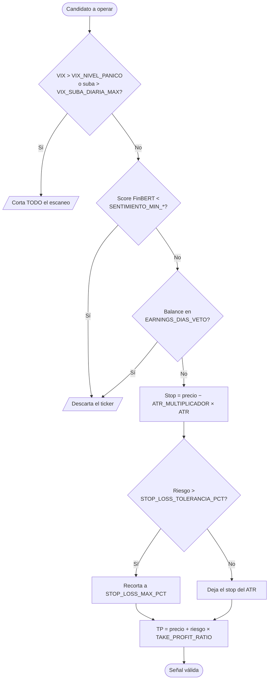

# Parámetros de riesgo del sistema

> [!warning] ESTADO: PROVISORIO — FALTA CONFIRMACIÓN HUMANA (Tarea 0.1)
> Estos valores son los que traen por defecto los manuales originales
> (`Manual_Maestro_Bot_Inversion_IA_Completo.docx`, sección 3, y
> `Manual_Maestro_Bot_Bonos_Soberanos_Provinciales.docx`, sección 3).
> Se cargaron acá para desbloquear las tareas de código que los necesitan
> (3.2, 9.2 y 11.2), **no porque estén acordados**.
>
> Antes de operar con dinero real hay que revisarlos y firmarlos con el dueño del
> capital, y actualizar `backend/app/config.py` si cambian.

## Cómo se aplican al evaluar una señal

## Capital y tamaño de posición

| Parámetro | Valor | Significado |
|---|---|---|
| `CAPITAL_TOTAL` | `100_000.0` ARS | Capital total asignado al sistema. |
| `MAX_POSICIONES` | `2` | Posiciones abiertas simultáneas como máximo. |
| `MONTO_POR_POSICION` | `50_000.0` ARS | Monto máximo por posición (50% del capital). |

## Gestión de riesgo por operación

| Parámetro | Valor | Significado |
|---|---|---|
| `STOP_LOSS_MAX_PCT` | `0.030` (3,0%) | Pérdida máxima estricta por operación. El stop dinámico por ATR (1,5 × ATR) nunca puede quedar más lejos que esto. |
| `STOP_LOSS_TOLERANCIA_PCT` | `0.035` (3,5%) | Umbral por encima del cual el stop calculado por ATR se recorta a `STOP_LOSS_MAX_PCT`. Es el `if pct_riesgo > 0.035` del manual (sección 6). |
| `ATR_MULTIPLICADOR` | `1.5` | Multiplicador del ATR(14) para ubicar el stop-loss. |
| `TAKE_PROFIT_RATIO` | `2.0` | Ratio riesgo/beneficio mínimo exigido: 1:2. |

> [!warning] El tope efectivo es 3,5%, no 3,0%
> `STOP_LOSS_MAX_PCT` solo se aplica **si el riesgo calculado supera
> `STOP_LOSS_TOLERANCIA_PCT`**. Una operación con riesgo de 3,27% queda tal cual,
> por encima del 3,0% nominal (se observó en AMZN durante la Tarea 3.2). Es el
> comportamiento del manual, replicado a propósito — pero conviene decidirlo
> explícitamente al confirmar la Tarea 0.1.

## Umbrales de veto por riesgo de mercado

| Parámetro | Valor | Significado |
|---|---|---|
| `VIX_NIVEL_PANICO` | `25.0` | Por encima de este nivel del VIX no se autorizan compras. |
| `VIX_SUBA_DIARIA_MAX` | `0.10` (10%) | Suba intradiaria del VIX que dispara el circuit breaker. |
| `SENTIMIENTO_MIN_ACCIONES` | `-0.35` | Score FinBERT promedio por debajo del cual se veta una acción/CEDEAR. |
| `SENTIMIENTO_MIN_BONOS` | `-0.30` | Score FinBERT promedio por debajo del cual se veta un bono. |
| `EARNINGS_DIAS_VETO` | `7` | Días antes de un balance en los que no se abre posición. |

## Renta fija (bonos)

| Parámetro | Valor | Significado |
|---|---|---|
| `SPREAD_BID_ASK_MAX` | `0.006` (0,6%) | Spread máximo en Contado Inmediato para considerar líquido un bono. |
| `CUPON_DIA_DESDE` / `CUPON_DIA_HASTA` | `1` / `12` | Ventana del mes de corte en la que no se compra por cupón inminente. |
| `RVOL_ACUMULACION_BONOS` | `1.8` | RVOL a partir del cual se considera acumulación institucional en bonos. |

## Smart money (contexto, no filtro obligatorio)

| Parámetro | Valor | Significado |
|---|---|---|
| `RVOL_ACUMULACION` | `2.0` | RVOL a partir del cual se marca acumulación institucional en acciones. |
| `INSIDERS_MIN_FILINGS` | `2` | Cantidad de filings Form 4 recientes para marcar compras de directores. |

> [!note] Estos dos no vetan
> Se informan como contexto adicional. Un RVOL bajo o la ausencia de filings no
> invalidan una señal.

## Gestión de salidas (Tarea 3.5 — `PositionManager`)

Reemplaza al take-profit fijo R/B 1:2 una vez que la posición ya está abierta.

| Parámetro | Valor | Significado |
|---|---|---|
| `SALIDA_SL_INICIAL_PCT` | `0.030` (-3,0%) | Stop inicial sobre el 100% de la posición. |
| `SALIDA_TP1_PCT` | `0.045` (+4,5%) | Vende el 50% y cancela el stop inicial. |
| `SALIDA_PISO_GARANTIZADO_PCT` | `0.035` (+3,5%) | Piso infranqueable del remanente una vez cobrado el TP1. |
| `SALIDA_TRAILING_PULLBACK` | `0.012` (1,2%) | Retroceso máximo tolerado desde el pico. El stop solo sube. |
| `SALIDA_TP2_PCT` | `0.080` (+8,0%) | Techo: cierra el remanente. |
| `SALIDA_HORA_CIERRE_PREVENTIVO` | `16:50` ART | Si queda posición con TP1 cobrado, se liquida a mercado. Cero riesgo overnight. |
| `TZ_BYMA` | `America/Argentina/Buenos_Aires` | Zona horaria de la rueda local. |

> [!note] Por qué el cierre de las 16:50
> Evita el gap bajista nocturno: una caída en Wall Street o una noticia local
> pueden abrir el papel con un hueco negativo a las 11:00 del día siguiente. Se
> prioriza asegurar el profit real en caja.

## Filtros de entrada (Tarea 4.4 — `EntryValidator`)

| Parámetro | Valor | Significado |
|---|---|---|
| `ENTRADA_MAX_CHASE_PCT` | `0.010` (+1,0%) | Tolerancia máxima sobre el nivel de ruptura. Más arriba, la señal se considera vencida. |
| `ENTRADA_MERCADO_CAIDA_MAX` | `-0.010` (-1,0%) | Caída diaria del índice a partir de la cual se bloquean todas las compras. |
| `SMA_BENCHMARK_PERIODO` | `200` | Ruedas de la media móvil diaria del benchmark. |
| `BENCHMARK_POR_TIPO` | CEDEAR→`SPY`, ACCION→`^MERV`, BONO→`None` | Índice de referencia según el instrumento. |

> [!warning] El régimen de mercado vetea ante falta de datos
> Si no se puede traer el benchmark, `chequear_regimen_mercado` **veta**
> (fail-safe), igual que el circuit breaker de VIX: dejar pasar habilitaría el
> universo entero justo el día que Yahoo no responde.

## Ejecución real

| Parámetro | Valor | Significado |
|---|---|---|
| `EJECUCION_REAL_HABILITADA` | `false` | Kill switch. Mientras esté en `false`, el sistema genera y notifica señales pero nunca envía una orden a IOL. |

## Cómo cambiar estos valores

> [!todo] Procedimiento
> Editar `backend/app/config.py` y reflejar el cambio acá. Ningún módulo debe
> hardcodear estos números.
