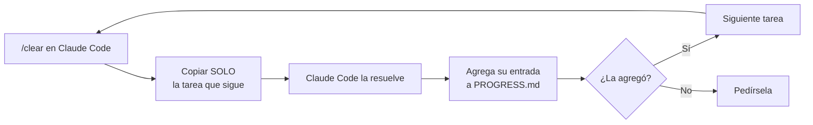
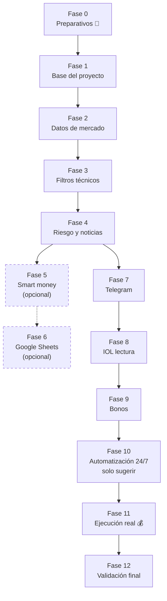

# Simulador / Bot de Inversión IA — Tareas de Desarrollo

## Cómo usar este archivo

1. Antes de cada tarea, corré `/clear` en Claude Code (excepto la primera vez).
2. Copiá SOLO la tarea que sigue (no el archivo entero) y pegásela a Claude Code.
3. Cuando termine, va a agregar su entrada a `PROGRESS.md`. Revisá que lo haya hecho.
4. Pasás a la tarea siguiente.

> [!warning] Una tarea por vez
> No le pegues varias tareas juntas ni le adelantes las que siguen — cada una debe
> resolverse con el contexto mínimo necesario (eso es lo que ahorra tokens y evita
> que la IA se adelante a hacer cosas que no le pediste todavía).

### Dos tipos de tarea en este archivo

| Marca | Tipo | Cómo se usa |
|---|---|---|
| 🤖 | **Tarea para Claude Code** | Se pega tal cual, como en el ejemplo de siempre. |
| 👤 | **Tarea manual (tuya)** | Gestiones, cuentas o decisiones que nadie puede automatizar por vos. **NO se pegan a Claude Code.** Están intercaladas en el orden en que hacen falta, porque varias tareas de código dependen de que las hayas resuelto antes (credenciales, tokens, cuentas). |

### Mapa de fases

**Referencias de spec:** apuntan a los manuales originales que armó tu amigo
(`Manual_Maestro_Bot_Inversion_IA_Completo.docx`, `Manual_Maestro_Bot_Bonos_Soberanos_Provinciales.docx`,
`Manual_Integracion_Google_Sheets_Trading_Bot.docx`, `Guia_IOL_Integracion_IA_Comisiones.docx`,
`Guia_Completa_Sistema_Inversion_IA_noticias.docx`, `pasar_ulises_31_2.docx`,
`Pasar_ulises_31_de_agosto.docx`) — indicadas en cada tarea. Compartí el manual
correspondiente junto con la tarea si Claude Code no tiene acceso directo al
archivo.

**Punto de partida:** las Fases 0 y 1 asumen que ya tenés el proyecto base
(`simulador-inversiones/`, backend FastAPI + frontend Next.js) que armamos en
esta conversación, con el simulador de paper trading funcionando. Todo lo que
sigue se construye encima de esa base.

> [!info] Historial de actualizaciones
> **31/8** — se suman las Tareas 3.5 y 3.6 (gestión dinámica de salidas —
> `PositionManager`: TP1 parcial, trailing stop con piso, TP2, cierre
> preventivo 16:50 hs) y las Tareas 4.4 y 4.5 (filtro de régimen de mercado +
> anti-chase — `EntryValidator`), a partir de dos documentos nuevos que
> compartió tu amigo. Además se ajustaron las Tareas 3.2, 10.1, 10.2 y 11.1
> para que queden consistentes con estos dos módulos nuevos.

---

## FASE 0 — Preparativos y Gestiones Previas

### Tarea 0.1 — 👤 Definir capital y parámetros de riesgo con tu amigo
**Objetivo:** Tener acordado, por escrito, con qué reglas va a operar el sistema
antes de que exista una sola línea de código que ejecute órdenes.

**Pasos:**
- Definir capital total asignado al sistema (los manuales usan $100.000 ARS de
  ejemplo, en 2 posiciones de $50.000).
- Definir stop-loss máximo por posición (los manuales usan 3.0% estricto) y
  ratio riesgo/beneficio mínimo (1:2).
- Definir tamaño máximo por posición como % del capital (los manuales
  recomiendan 15-20% máximo en un solo activo).
- Guardar esto en un archivo `docs/parametros-riesgo.md` en el repo — todas las
  tareas de las Fases 3, 9 y 11 lo van a usar como fuente de verdad.

**Resultado esperado:** un documento corto con los números acordados, no una
opinión — esto evita discutir parámetros de riesgo a mitad de una tarea de
código.

---

### Tarea 0.2 — 👤 Gestionar credenciales de API en InvertirOnline (IOL)
**Objetivo:** Tener usuario, contraseña y acceso de API habilitado en la cuenta
comitente de tu amigo (ya tiene cuenta, falta esto).

**Pasos:**
- Ingresar a la cuenta de IOL de tu amigo, sección de configuración/API, y
  habilitar el acceso API (según `Guia_IOL_Integracion_IA_Comisiones.docx`,
  sección 3, punto 1).
- Guardar usuario y contraseña en un gestor de contraseñas — **nunca** en el
  repo ni en un chat.
- No hace falta tenerlo listo para arrancar (Fases 1 a 7 no lo usan), pero sí
  antes de la Fase 8.

**Resultado esperado:** credenciales de IOL activas y guardadas de forma segura.

---

### Tarea 0.3 — 👤 Crear bot de Telegram y obtener token
**Objetivo:** Tener un `TELEGRAM_BOT_TOKEN` y `TELEGRAM_CHAT_ID` listos para
las alertas (Fase 7).

**Pasos:**
- Hablar con `@BotFather` en Telegram, crear un bot nuevo (`/newbot`), guardar
  el token que te da.
- Enviarle un mensaje cualquiera al bot recién creado y usar
  `https://api.telegram.org/bot<TOKEN>/getUpdates` para obtener el `chat_id`.
- Guardar ambos valores para cargarlos como variables de entorno más adelante.

**Resultado esperado:** token y chat_id verificados (probá mandarte un mensaje
de prueba con `curl` contra la API de Telegram).

---

### Tarea 0.4 — 👤 Crear cuenta de servicio de Google y hoja de cálculo (opcional)
**Objetivo:** Tener la cuenta de servicio de Google Cloud y la hoja
`Trading_Log_IOL` listas, si deciden usar Google Sheets como bitácora
adicional (Fase 6 — opcional, la app ya cumple ese rol).

**Pasos:** seguir textual `Manual_Integracion_Google_Sheets_Trading_Bot.docx`,
sección 3 (crear proyecto en Google Cloud Console, habilitar Sheets API y
Drive API, crear cuenta de servicio, descargar `credenciales_google.json`,
compartir la hoja con el email de la cuenta de servicio como Editor).

**Resultado esperado:** archivo `credenciales_google.json` descargado (no
subir al repo) y hoja compartida.

---

### Tarea 0.5 — 👤 Elegir y contratar VPS
**Objetivo:** Tener un servidor donde el sistema corra 24/7, para cuando
lleguen las Fases 10-11.

**Pasos:**
- Evaluar Oracle Cloud Free Tier (costo $0) vs. Hetzner/DigitalOcean (USD
  6-12/mes) — ver `Guia_Completa_Sistema_Inversion_IA_noticias.docx`, tabla de
  costos de infraestructura paga.
- Provisionar Ubuntu 22.04 o 24.04 LTS.
- Guardar el acceso SSH.

**Resultado esperado:** VPS accesible por SSH. No hace falta resolver esto
antes de la Fase 10.

---

## FASE 1 — Consolidar la Base del Proyecto

### Tarea 1.1 — 👤 Importar el proyecto ya generado a un repo Git
**Objetivo:** Tener el simulador de paper trading (backend FastAPI + frontend
Next.js que ya te entregué) versionado en un repositorio propio.

**Pasos:**
- Descomprimir `simulador-inversiones.zip` en tu máquina.
- `git init`, primer commit, subir a GitHub/GitLab (repo privado).
- Confirmar que `backend/venv/`, `backend/simulador.db`,
  `frontend/node_modules/` y `frontend/.next/` están en `.gitignore` (ya viene
  armado).

**Resultado esperado:** repo creado, primer commit hecho, push funcionando.

---

### Tarea 1.2 — 🤖 Documentar convenciones del repo para Claude Code
**Objetivo:** Crear `CLAUDE.md` y `PROGRESS.md` en la raíz del repo para que
cada tarea futura mantenga contexto mínimo y quede un historial de lo hecho.

**Alcance:**
- `CLAUDE.md`: describir brevemente el proyecto (simulador de paper trading
  que evoluciona hacia un bot de trading cuantitativo para CEDEARs y bonos
  argentinos vía IOL), la estructura de carpetas (`backend/`, `frontend/`), y
  la instrucción explícita de agregar una entrada a `PROGRESS.md` al terminar
  cada tarea (fecha, tarea resuelta, archivos tocados, cómo se probó).
- `PROGRESS.md`: crear con una primera entrada retroactiva describiendo el
  estado actual (simulador de paper trading funcionando, backend FastAPI +
  SQLite, frontend Next.js con Dashboard/Simulador/Configuración).

**Fuera de alcance:** no tocar código de la app todavía.

**Referencia de spec:** ninguna (es organización interna del repo).

**Criterio de aceptación:**
- Existen `CLAUDE.md` y `PROGRESS.md` en la raíz con el contenido descripto.

**Testing esperado:** no aplica (son archivos de documentación).

---

### Tarea 1.3 — 🤖 Tests automatizados de las fórmulas de comisión
**Objetivo:** Cubrir con tests `backend/app/calculations.py`, que es el
corazón matemático de todo el sistema (de acá dependen todas las decisiones
de compra/venta futuras).

**Alcance:**
- Agregar `pytest` a `requirements.txt`.
- Crear `backend/tests/test_calculations.py` con casos que repliquen las 5
  operaciones de ejemplo del `Simulador_Inversiones_IA_Paper_Trading.xlsx`
  original (AAPL, NVDA, NXE, MELI, TSLA) y verifiquen que
  `compute_trade()` devuelve los mismos resultados netos que la planilla.
- Agregar un test de `BrokerRates` que verifique que con los valores por
  defecto (0.5% / 0.08% / 21%) el costo por tramo da 0.7018% y el de ida y
  vuelta 1.4036%.

**Fuera de alcance:** tests de los endpoints HTTP (eso va en una tarea aparte
si hace falta).

**Referencia de spec:** `Simulador_Inversiones_IA_Paper_Trading.xlsx` (valores
de referencia) y `Guia_IOL_Integracion_IA_Comisiones.docx`, sección 1 (tabla
de comisiones).

**Criterio de aceptación:** `pytest` corre en verde con al menos 6 casos de
test (5 operaciones + 1 de tasas).

**Testing esperado:** correr `pytest` desde `backend/` y pegar la salida en
`PROGRESS.md`.

---

## FASE 2 — Datos de Mercado en Vivo

### Tarea 2.1 — 🤖 Módulo de precios en vivo con yfinance
**Objetivo:** Poder consultar el precio actual y el histórico OHLCV de un
ticker sin cargarlo a mano.

**Alcance:**
- Agregar `yfinance` y `pandas` a `requirements.txt`.
- Crear `backend/app/market_data.py` con dos funciones: `get_last_price(ticker)`
  (último precio de cierre) y `get_history(ticker, period="60d")` (DataFrame
  OHLCV).
- Manejar el caso de ticker inválido o sin datos (excepción controlada, no
  que rompa el proceso).

**Fuera de alcance:** no tocar el frontend ni los filtros técnicos todavía.

**Referencia de spec:** `Manual_Maestro_Bot_Inversion_IA_Completo.docx`,
sección 6 (import de `yfinance`, cálculo de ATR usa el mismo `history()`).

**Criterio de aceptación:** `get_last_price("AAPL")` y `get_history("AAPL")`
devuelven datos reales al correrlos manualmente.

**Testing esperado:** script o test que llame a ambas funciones con un ticker
real (AAPL) y con uno inválido (XXXX123) y muestre el resultado de los dos
casos.

---

### Tarea 2.2 — 🤖 Autocompletar precio actual en el simulador
**Objetivo:** Que al cargar una operación nueva en el frontend, el precio de
entrada se pueda autocompletar con el precio real de mercado en vez de
tipearlo a mano.

**Alcance:**
- Endpoint `GET /market/precio/{ticker}` en el backend que use
  `market_data.get_last_price`.
- En `frontend/components/NewTradeForm.tsx`, agregar un botón "Usar precio de
  mercado" al lado del campo Ticker que llame a ese endpoint y complete
  `precio_entrada`.

**Fuera de alcance:** no auto-cargar la operación completa, solo el precio.

**Referencia de spec:** ninguna nueva (es UX sobre lo ya construido).

**Criterio de aceptación:** tipear "AAPL" y tocar el botón completa el campo
precio con un valor numérico real.

**Testing esperado:** captura de pantalla o descripción del flujo probado
manualmente en el navegador.

---

## FASE 3 — Motor de Filtros Técnicos (CEDEARs / Acciones)

### Tarea 3.1 — 🤖 Cálculo de ATR y medias móviles
**Objetivo:** Tener las funciones matemáticas base que usan los 7 filtros.

**Alcance:**
- Crear `backend/app/technical_filters.py`.
- Portar `calculate_atr(df, period=14)` tal cual está en el manual.
- Agregar helper para EMA20 y EMA50 sobre un DataFrame de precios.

**Fuera de alcance:** no implementar los 7 filtros todavía, solo las piezas
matemáticas.

**Referencia de spec:** `Manual_Maestro_Bot_Inversion_IA_Completo.docx`,
sección 6 (`technical_filters.py`, función `calculate_atr`).

**Criterio de aceptación:** funciones probadas contra un DataFrame de ejemplo
(puede ser el histórico real de AAPL vía `market_data.get_history`).

**Testing esperado:** imprimir el ATR y las EMAs calculadas para AAPL y
verificar a ojo que los valores son razonables (no negativos, no NaN al final
de la serie).

---

### Tarea 3.2 — 🤖 Implementar los 7 filtros de validación técnica
**Objetivo:** Portar `evaluate_7_filters(ticker)` del manual al proyecto,
adaptado para devolver también el motivo cuando vetea una señal.

**Alcance:**
- En `technical_filters.py`, implementar la función completa: earnings
  próximos, régimen SPY (EMA50), tendencia del activo (precio > EMA20 >
  EMA50), fuerza relativa vs. SPY a 30 ruedas, ATR/stop-loss dinámico con
  tope de 3.5%, take-profit con R/B 1:2.
- Usar los parámetros de riesgo definidos en `docs/parametros-riesgo.md`
  (Tarea 0.1) en vez de hardcodear 3.0%/1:2 si difieren.
- Devolver siempre `(valido: bool, detalle: dict)`, con `detalle["motivo"]`
  cuando `valido=False`.

**Fuera de alcance:** no exponer esto como endpoint todavía (es la Tarea 3.3).
El `stop_loss`/`take_profit` (R/B 1:2) que calcula esta función es solo el
valor de referencia inicial en el momento de la señal — una vez abierta la
posición, la gestión real de la salida (toma de ganancia parcial, trailing,
cierre preventivo) la toma `PositionManager` (Tarea 3.5), no esta función.

**Referencia de spec:** `Manual_Maestro_Bot_Inversion_IA_Completo.docx`,
sección 6 completa (los 7 filtros están enumerados y con código).

**Criterio de aceptación:** correr la función contra 3-4 tickers reales
(algunos que pasen, algunos que veteen) y que el resultado tenga sentido con
lo que se ve en un gráfico de precios.

**Testing esperado:** tabla con ticker, resultado (válido/vetado) y motivo,
para al menos 5 tickers del universo BYMA (AAPL, NVDA, MELI, TSLA, KO).

---

### Tarea 3.3 — 🤖 Endpoint de escaneo de señales
**Objetivo:** Exponer el motor de filtros como una funcionalidad de la app,
no solo como script.

**Alcance:**
- Endpoint `GET /senales` que recorra un universo de tickers configurable
  (reusar `TICKERS_BYMA` del manual como default) y devuelva la lista de
  candidatos que pasaron los 7 filtros, con precio de entrada, stop-loss,
  take-profit sugeridos.
- Guardar el universo de tickers en `backend/app/config.py` (nuevo archivo,
  reemplaza al `config.py` de ejemplo del manual).

**Fuera de alcance:** todavía no hay filtro de noticias/riesgo (Fase 4) ni
frontend (Tarea 3.4) — el endpoint puede sugerir señales que después se
descarten por riesgo.

**Referencia de spec:** `Manual_Maestro_Bot_Inversion_IA_Completo.docx`,
secciones 3 y 8 (`config.py`, `bot_master.py` — la parte de recorrer
`TICKERS_BYMA`).

**Criterio de aceptación:** `GET /senales` devuelve JSON con 0 a N
candidatos, cada uno con motivo si fue descartado (o listado de descartes en
un campo separado, a criterio de implementación, pero no se pierden).

**Testing esperado:** llamar al endpoint y pegar la respuesta completa en
`PROGRESS.md`.

---

### Tarea 3.4 — 🤖 Página "Señales" en el frontend
**Objetivo:** Ver las señales sugeridas sin usar la terminal.

**Alcance:**
- Nueva página `frontend/app/senales/page.tsx`, agregada al `Nav`.
- Tabla con ticker, precio sugerido, stop-loss, take-profit, motivo de veto
  si corresponde.
- Botón "Cargar en el simulador" por cada señal válida que pre-complete
  `NewTradeForm` con esos datos (no crea la operación sola, solo prellena).

**Fuera de alcance:** no hay ejecución automática de nada acá, es solo
lectura + prellenado manual.

**Referencia de spec:** ninguna nueva.

**Criterio de aceptación:** la página muestra datos reales del endpoint
`/senales` y el botón de prellenado funciona.

**Testing esperado:** captura de pantalla de la página con al menos una señal
válida y una vetada.

---

### Tarea 3.5 — 🤖 Gestor de salidas dinámicas (PositionManager)
**Objetivo:** Reemplazar el take-profit fijo R/B 1:2 por una gestión de salida
en varias etapas — stop-loss inicial, toma de ganancia parcial, trailing stop
con piso, techo, y cierre preventivo de fin de rueda — aplicada primero sobre
las posiciones simuladas del paper trading.

**Alcance:**
- Crear `backend/app/position_manager.py`, portando la clase
  `PositionManager` del documento: constructor con `entry_price`, `total_qty`;
  parámetros `sl_initial_pct=0.03`, `tp1_pct=0.045`,
  `trailing_pullback=0.012`, `min_guaranteed_pct=0.035`, `tp2_pct=0.08`;
  método `on_tick(current_price, timestamp)` con la máquina de estados
  completa: SL inicial (-3.0%), TP1 parcial (vende 50% en +4.5% y cancela el
  SL inicial), trailing con piso garantizado (+3.5%) que solo puede subir,
  TP2 techo (+8.0%), y cierre preventivo a las 16:50 hs ART (con `pytz`) si
  ya se cobró TP1.
- Agregar `pytz` a `requirements.txt`.
- Persistir el estado por posición (`is_tp1_hit`, `max_price_since_tp1`,
  `current_stop_price`, `remaining_qty`) — agregar estos campos a una tabla
  nueva `PositionState` (o extender `Trade`) para no perder el seguimiento si
  el proceso se reinicia a mitad de rueda.

**Fuera de alcance:** no conectar esto todavía a la ejecución automática de
órdenes reales (eso es la Fase 11) ni al job continuo 24/7 (la Tarea 3.6 lo
aplica primero solo dentro del simulador).

**Referencia de spec:** `Pasar_ulises_31_de_agosto.docx`, secciones 2 y 3
completas (ciclo de vida de las 4 fases y la clase `PositionManager`).

**Criterio de aceptación:** una simulación con una serie de precios de
ejemplo dispara, en el orden correcto, TP1 parcial → ajuste del trailing con
piso → cierre por trailing o por TP2 → o cierre preventivo a las 16:50 hs si
corresponde.

**Testing esperado:** un test que alimente `on_tick` con una secuencia de
precios que recorra cada fase (entrada, suba a +4.5%, nueva suba, retroceso
de 1.2%) y verifique que devuelve las acciones esperadas en el orden
esperado.

---

### Tarea 3.6 — 🤖 Aplicar PositionManager a las posiciones abiertas del simulador
**Objetivo:** Que las operaciones "ABIERTA" del simulador se gestionen solas
durante la rueda, en vez de esperar a que vos cargues manualmente la fecha y
precio de salida.

**Alcance:**
- Job periódico (`backend/position_monitor_job.py`) que, cada pocos minutos
  durante el horario de rueda BYMA, recorra las operaciones con
  `estado_posicion="ABIERTA"`, consulte el precio actual
  (`market_data.get_last_price`, Tarea 2.1) y llame a `PositionManager.on_tick`.
- Cuando `on_tick` devuelve una acción de venta parcial o total, reflejarla
  en el simulador: decidir el enfoque más simple para soportar una venta
  parcial del 50% sin romper los cálculos ya existentes en
  `calculations.py` (por ejemplo, dividir la operación en dos registros: uno
  cerrado por el 50% vendido y otro que sigue abierto por el resto).
- Si la Fase 7 (Telegram) ya está implementada, notificar cada acción; si no,
  dejarlo preparado para conectarse cuando lo esté.

**Fuera de alcance:** no toca la cuenta real de IOL, todo esto sigue siendo
paper trading.

**Referencia de spec:** `Pasar_ulises_31_de_agosto.docx`, sección 5
(checklist técnico — persistencia de estado, tipo de orden a mercado,
sincronización horaria).

**Criterio de aceptación:** una operación abierta de prueba, cuando el
precio de mercado real cruza los umbrales de TP1/trailing/TP2, se actualiza
sola en el simulador sin intervención manual.

**Testing esperado:** cargar una operación de prueba con un ticker líquido,
dejar correr el job un rato en horario de mercado, y mostrar en
`PROGRESS.md` cómo fue cambiando de estado.

---

## FASE 4 — Filtro de Riesgo y Noticias (Circuit Breaker)

### Tarea 4.1 — 🤖 Circuit breaker de VIX
**Objetivo:** Poder vetar operaciones cuando el mercado global está en pánico.

**Alcance:**
- Crear `backend/app/risk_filters.py`.
- Portar `check_vix_circuit_breaker()` del manual (veta si VIX > 25 o subió
  más de 10% en el día).
- Endpoint `GET /riesgo/vix` que devuelva el estado actual (para mostrarlo en
  el dashboard).

**Fuera de alcance:** el filtro de noticias por FinBERT es la tarea 4.2, no
mezclar en esta.

**Referencia de spec:** `Manual_Maestro_Bot_Inversion_IA_Completo.docx`,
sección 4 (`macro_news.py`, función `check_vix_circuit_breaker`).

**Criterio de aceptación:** el endpoint responde con el VIX actual y si está
en modo veto o no (se puede verificar contra el valor real de `^VIX` ese día).

**Testing esperado:** llamar al endpoint y confirmar que el valor devuelto es
coherente con el VIX real del día (buscarlo en cualquier fuente pública).

---

### Tarea 4.2 — 🤖 Filtro de sentimiento de noticias (FinBERT)
**Objetivo:** Vetar señales cuando las noticias recientes de un activo son
muy negativas, sin depender de leerlas a mano.

**Alcance:**
- Agregar `feedparser`, `transformers`, `torch` a `requirements.txt` (ojo:
  son pesados, avisar si el entorno de deploy tiene RAM limitada — VPS free
  tier puede no alcanzar; dejarlo señalado en `PROGRESS.md` si pasa).
- Portar `get_finbert_sentiment(ticker)` del manual: descarga RSS de Yahoo
  Finance, corre FinBERT localmente, vetea si hay palabras críticas
  (`war`, `sanction`, `bank run`, `fraud`, `default`, `bankruptcy`,
  `sec probe`) o si el score promedio es menor a -0.35.
- Cachear el modelo cargado (no recargar FinBERT en cada llamada).

**Fuera de alcance:** no integrarlo todavía al endpoint `/senales` (eso es la
Tarea 4.3).

**Referencia de spec:** `Manual_Maestro_Bot_Inversion_IA_Completo.docx`,
sección 4 completa (`macro_news.py`, función `get_finbert_sentiment`).

**Criterio de aceptación:** correr la función contra 2-3 tickers reales y que
devuelva un score entre -1 y 1 coherente con el tono de las noticias
recientes de cada uno.

**Testing esperado:** tabla con ticker, score, y 1-2 titulares usados para el
cálculo.

---

### Tarea 4.3 — 🤖 Integrar el veto de riesgo al escaneo de señales
**Objetivo:** Que `/senales` (Tarea 3.3) no sugiera nada si el circuit
breaker de VIX está activo, y descarte por ticker si el sentimiento de
noticias es negativo.

**Alcance:**
- Modificar el endpoint `/senales`: primero chequear `check_vix_circuit_breaker()`
  — si vetea, devolver lista vacía con el motivo global.
- Por cada ticker candidato, chequear `get_finbert_sentiment` antes de
  aplicar los 7 filtros técnicos; si vetea, marcarlo como descartado con ese
  motivo en vez de evaluarlo técnicamente.

**Fuera de alcance:** no tocar el frontend (ya debería andar solo, porque
consume el mismo endpoint).

**Referencia de spec:** `Manual_Maestro_Bot_Inversion_IA_Completo.docx`,
sección 8 (`bot_master.py`, función `scan_and_execute` — el orden de chequeos
es: VIX → noticias → smart money → 7 filtros).

**Criterio de aceptación:** con el VIX en modo normal, el escaneo funciona
como antes; simulando (con un test o mock) un VIX > 25, `/senales` devuelve
lista vacía con motivo "VETO: VIX en pánico".

**Testing esperado:** un test que mockee `check_vix_circuit_breaker` para
devolver veto y confirme que `/senales` respeta ese corte.

---

### Tarea 4.4 — 🤖 Filtro de régimen de mercado y vigencia de señal (EntryValidator)
**Objetivo:** Sumar dos filtros de calidad más a los 7 filtros técnicos: no
comprar en días de caída generalizada del mercado de referencia, y no
"perseguir" un precio que ya se escapó del nivel de ruptura.

**Alcance:**
- Crear `backend/app/entry_validator.py`, portando la clase `EntryValidator`
  del documento: `is_market_healthy(market_index_price, market_index_sma200,
  market_daily_change_pct)` (Filtro 1: índice > SMA200 diaria y caída diaria
  >= -1.0%) e `is_signal_valid(current_price, breakout_level)` (Filtro 2:
  tolerancia máxima de +1.0% sobre el nivel de ruptura), más el método
  compuesto `can_open_position`.
- El benchmark depende del tipo de instrumento: SPY o QQQ para CEDEARs,
  índice Merval (IMV) para acciones argentinas (tipo `ACCION` en el modelo
  actual) — usar `market_data.get_history`/`get_last_price` (Tarea 2.1) para
  traer el precio del índice correspondiente y calcular su SMA200.
- El `breakout_level` debe congelarse en el momento exacto en que
  `evaluate_7_filters` (Tarea 3.2) valida la señal técnica — no recalcularlo
  en cada chequeo posterior.

**Fuera de alcance:** no integrarlo todavía al endpoint `/senales` (Tarea 4.5).

**Referencia de spec:** `pasar_ulises_31_2.docx`, secciones 1 a 3 completas
(cuadro de los dos filtros y clase `EntryValidator`).

**Criterio de aceptación:** `can_open_position` probado con casos reales
(mercado sano + señal vigente → aprobado; mercado bajo SMA200 → rechazado;
precio extendido más de 1% del breakout → rechazado).

**Testing esperado:** tabla con 3 escenarios de prueba (uno por cada motivo
de rechazo posible, más uno aprobado) y el resultado de cada uno.

---

### Tarea 4.5 — 🤖 Integrar EntryValidator al escaneo de señales
**Objetivo:** Que ningún candidato llegue a `/senales` sin pasar también por
el filtro de régimen de mercado y el de vigencia de señal, respetando el
orden que minimiza llamadas a la API.

**Alcance:**
- Modificar el endpoint `/senales` (Tarea 3.3) y su integración con riesgo
  (Tarea 4.3) para que el orden de chequeo quede: VIX circuit breaker →
  régimen de mercado del benchmark correspondiente (si no está sano, se
  descarta toda la lista de un saque, sin evaluar tickers individuales) →
  por cada ticker: noticias FinBERT → 7 filtros técnicos → vigencia de señal
  (anti-chase) contra el `breakout_level` calculado en ese mismo paso.
- Cuando el filtro de régimen de mercado rechaza, guardar el motivo global
  (igual que se hace hoy con el veto de VIX).

**Fuera de alcance:** no tocar el frontend de señales salvo que el nuevo
motivo de descarte no se esté mostrando (en ese caso, un ajuste menor y
suficiente).

**Referencia de spec:** `pasar_ulises_31_2.docx`, sección 5 (checklist —
orden de ejecución de filtros).

**Criterio de aceptación:** `/senales` nunca devuelve un candidato cuyo
precio actual esté más de 1.0% por encima de su nivel de ruptura, ni ninguno
cuando el benchmark correspondiente está en tendencia bajista o cayó fuerte
en el día.

**Testing esperado:** respuesta completa de `/senales` en un día real,
mostrando al menos un caso descartado por cada uno de los dos filtros nuevos
(si el mercado no da el caso naturalmente ese día, simularlo con un
test/mock y dejarlo documentado).

---

## FASE 5 — Smart Money / Insiders (opcional, contexto adicional)

### Tarea 5.1 — 🤖 Detector de volumen anómalo (RVOL)
**Objetivo:** Detectar acumulación institucional oculta como señal de
contexto (no como filtro obligatorio).

**Alcance:**
- Crear `backend/app/smart_money.py`.
- Portar `check_unusual_volume(ticker)` del manual (RVOL = volumen actual /
  promedio de 20 ruedas; `es_acumulacion` si RVOL >= 2.0).

**Fuera de alcance:** el scanner de SEC Form 4 es la Tarea 5.2, no mezclar.

**Referencia de spec:** `Manual_Maestro_Bot_Inversion_IA_Completo.docx`,
sección 5 (`insider_smartmoney.py`, función `check_unusual_volume`).

**Criterio de aceptación:** función probada contra 2-3 tickers reales,
devuelve un RVOL numérico coherente.

**Testing esperado:** tabla ticker → RVOL para 3 tickers.

---

### Tarea 5.2 — 🤖 Scanner de compras de directores (SEC Form 4)
**Objetivo:** Sumar como contexto si hay compras recientes de insiders.

**Alcance:**
- Portar `check_sec_form4_cluster(ticker)` del manual a `smart_money.py`.
- Sumar `rvol` y `insiders` como campos extra en la respuesta de `/senales`
  (Tarea 3.3), sin que afecten si la señal es válida o no — es información,
  no un filtro obligatorio.

**Fuera de alcance:** no bloquear ninguna señal por esto.

**Referencia de spec:** `Manual_Maestro_Bot_Inversion_IA_Completo.docx`,
sección 5 (`insider_smartmoney.py`, función `check_sec_form4_cluster`).

**Criterio de aceptación:** `/senales` incluye `rvol` e `insiders_detectados`
en cada resultado.

**Testing esperado:** respuesta de `/senales` mostrando estos campos
poblados para al menos un ticker real.

---

## FASE 6 — Integración con Google Sheets (opcional)

> [!note] Fase opcional
> La app ya cumple el rol de bitácora que cumplía el
> Excel/Sheets original. Solo tiene sentido si tu amigo quiere revisar los
> números desde el celular en Google Sheets sin abrir la app.

### Tarea 6.1 — 🤖 Módulo de sincronización a Google Sheets
**Objetivo:** Poder espejar las operaciones cerradas del simulador a la hoja
`Trading_Log_IOL`.

**Alcance:**
- Agregar `gspread` y `oauth2client` a `requirements.txt`.
- Crear `backend/app/sheets_sync.py`, adaptando `SheetsAuditLogger` del
  manual para leer los datos desde la base propia (no desde parámetros
  sueltos) y escribir una fila por operación cerrada.
- Leer la ruta de `credenciales_google.json` desde una variable de entorno.

**Fuera de alcance:** no correr esto automáticamente todavía (Tarea 6.2).

**Referencia de spec:** `Manual_Integracion_Google_Sheets_Trading_Bot.docx`,
sección 4 (`sheets_logger.py`) y sección "TABLE" con la estructura de
columnas A-K.

**Criterio de aceptación:** correr el módulo manualmente sincroniza al menos
una operación cerrada real a la hoja de Google Sheets de prueba.

**Testing esperado:** captura de pantalla de la hoja con la fila sincronizada.

---

### Tarea 6.2 — 🤖 Endpoint y botón de sincronización manual
**Objetivo:** Disparar la sincronización desde la app, sin usar la terminal.

**Alcance:**
- Endpoint `POST /sync/sheets` que sincronice todas las operaciones cerradas
  no sincronizadas aún (agregar campo `sincronizado_sheets: bool` al modelo
  `Trade`).
- Botón "Sincronizar con Sheets" en `frontend/app/simulador/page.tsx`.

**Fuera de alcance:** sincronización automática en tiempo real — queda para
cuando haya un bot corriendo 24/7 (Fase 10).

**Referencia de spec:** `Manual_Integracion_Google_Sheets_Trading_Bot.docx`,
sección 5.

**Criterio de aceptación:** tocar el botón sincroniza las operaciones
pendientes y las marca como sincronizadas (no se duplican en un segundo
click).

**Testing esperado:** flujo probado dos veces seguidas confirmando que la
segunda vez no duplica filas.

---

## FASE 7 — Alertas por Telegram

### Tarea 7.1 — 🤖 Módulo de notificaciones Telegram
**Objetivo:** Poder mandar un mensaje a Telegram desde el backend.

**Alcance:**
- Crear `backend/app/notifications.py` con función `send_telegram(mensaje)`,
  usando `TELEGRAM_BOT_TOKEN` y `TELEGRAM_CHAT_ID` desde variables de
  entorno (obtenidas en la Tarea 0.3).
- Endpoint de prueba `POST /notificaciones/test` que mande un mensaje fijo.

**Fuera de alcance:** no conectar esto a ningún evento real todavía (Tarea
7.2).

**Referencia de spec:** `Manual_Maestro_Bot_Inversion_IA_Completo.docx`,
sección 8 (`bot_master.py`, función `send_telegram`).

**Criterio de aceptación:** llamar al endpoint de prueba hace llegar un
mensaje real al Telegram configurado.

**Testing esperado:** captura de pantalla del mensaje recibido en Telegram.

---

### Tarea 7.2 — 🤖 Conectar alertas a eventos clave
**Objetivo:** Recibir notificación automática cuando pase algo relevante,
sin tener que estar mirando la app.

**Alcance:**
- Al crear una señal válida en `/senales` (opcional: solo si se agrega un
  modo "vigilancia continua" — si no existe todavía, dejarlo para la Fase
  10 y en esta tarea limitarse a notificar cierres de posición).
- Al cerrar una operación en el simulador (`POST /trades/{id}/cerrar`),
  disparar `send_telegram` con el resumen (ticker, resultado neto, %).

**Fuera de alcance:** notificaciones de veto por VIX/noticias — opcional,
agregar solo si sobra tiempo, no es crítico en esta fase.

**Referencia de spec:** `Manual_Maestro_Bot_Inversion_IA_Completo.docx`,
sección 8 (formato del mensaje de compra ejecutada, como referencia de
estilo).

**Criterio de aceptación:** cerrar una operación real en el simulador manda
un mensaje a Telegram con los datos correctos.

**Testing esperado:** cerrar una operación de prueba y mostrar el mensaje
recibido.

---

## FASE 8 — Integración con IOL (modo lectura)

> [!warning] Requisito previo
> Requiere la Tarea 0.2 resuelta (credenciales de API de IOL).

### Tarea 8.1 — 🤖 Cliente de autenticación OAuth2 de IOL
**Objetivo:** Poder autenticarse contra la API de IOL y mantener el token
vigente.

**Alcance:**
- Crear `backend/app/broker_iol.py` con clase `IOLClient` (login, refresco de
  token, `get_headers()`) — portar tal cual la lógica del manual.
- Credenciales desde variables de entorno (`IOL_USERNAME`, `IOL_PASSWORD`),
  nunca hardcodeadas.
- Manejo de error claro si el login falla (credenciales mal cargadas,
  servicio caído, etc.).

**Fuera de alcance:** no consultar saldo ni cotizaciones todavía (Tarea 8.2).

**Referencia de spec:** `Manual_Maestro_Bot_Inversion_IA_Completo.docx`,
sección 7 (`broker_iol.py`, clase `IOLClient`, métodos `login` y
`get_headers`).

**Criterio de aceptación:** `IOLClient()` se instancia y loguea
correctamente contra la cuenta real de tu amigo (usar credenciales de
prueba/lectura, no ejecutar nada).

**Testing esperado:** log de consola mostrando "Autenticación exitosa en
IOL." (sin exponer el token en el log).

---

### Tarea 8.2 — 🤖 Consultar saldo y tenencia real (solo lectura)
**Objetivo:** Ver en el dashboard el saldo real disponible en la cuenta de
IOL, sin tocar nada.

**Alcance:**
- Método `get_saldo_disponible()` en `IOLClient` (ya está en el manual).
- Endpoint `GET /iol/saldo` que exponga el saldo en pesos.
- Card nueva en `frontend/app/page.tsx` (Dashboard) mostrando el saldo real
  al lado de las métricas del simulador — dejar claro visualmente que una
  cosa es plata real y otra es paper trading (por ejemplo, con un borde de
  otro color y la leyenda "CUENTA REAL — IOL").

**Fuera de alcance:** no consultar cotizaciones de instrumentos todavía, ni
enviar ninguna orden — este endpoint es puramente de lectura.

**Referencia de spec:** `Manual_Maestro_Bot_Inversion_IA_Completo.docx`,
sección 7 (`get_saldo_disponible`).

**Criterio de aceptación:** el dashboard muestra el saldo real actual de la
cuenta, verificable comparándolo con lo que muestra la app/web de IOL.

**Testing esperado:** captura de pantalla del dashboard con el saldo real
mostrado, y captura de la app de IOL confirmando que coincide.

---

### Tarea 8.3 — 🤖 Endurecer manejo de credenciales
**Objetivo:** Antes de seguir, asegurarse de que ninguna credencial de IOL
quede expuesta en logs, en el repo o en respuestas de la API.

**Alcance:**
- Revisar que `.env` esté en `.gitignore` (ya debería estarlo) y agregar
  `.env.example` con las claves sin valores.
- Revisar que ningún endpoint ni log imprima el token de IOL completo.
- Documentar en `README.md` cómo cargar las credenciales al desplegar.

**Fuera de alcance:** no es una tarea de features, es un checkpoint de
seguridad — no agregar funcionalidad nueva acá.

**Referencia de spec:** `Guia_IOL_Integracion_IA_Comisiones.docx`, sección 3
("Regla de seguridad operativa").

**Criterio de aceptación:** `git grep` de la contraseña/token de prueba no
encuentra coincidencias en el repo; `.env.example` existe y está completo.

**Testing esperado:** pegar en `PROGRESS.md` la salida de
`git log --all -p | grep -i "iol_password"` (debe estar vacía).

---

## FASE 9 — Motor de Bonos Soberanos y Provinciales

### Tarea 9.1 — 🤖 Config y universo de bonos
**Objetivo:** Tener el listado de instrumentos de renta fija que va a
auditar el sistema.

**Alcance:**
- Agregar a `backend/app/config.py` las listas `BONOS_SOBERANOS` (AL30, GD30,
  AL35, GD35, AE38) y `BONOS_PROVINCIALES` (BA37D, CO26, NDT25, PMM29) del
  manual.
- Agregar campo `tipo="BONO"` como opción ya soportada en el modelo `Trade`
  (ya existe en el schema actual, confirmar que el frontend lo permite
  seleccionar — ya está en `TIPOS` de `NewTradeForm.tsx`).

**Fuera de alcance:** no implementar los filtros de bonos todavía.

**Referencia de spec:** `Manual_Maestro_Bot_Bonos_Soberanos_Provinciales.docx`,
sección 3 (`config_bonds.py`).

**Criterio de aceptación:** las listas existen en el código y son
importables desde otros módulos.

**Testing esperado:** no aplica más que confirmar el import sin errores.

---

### Tarea 9.2 — 🤖 Filtros institucionales para renta fija
**Objetivo:** Portar la lógica de evaluación de bonos (distinta a la de
acciones/CEDEARs).

**Alcance:**
- Crear `backend/app/fixed_income_filters.py`.
- Portar `evaluate_bond_filters(simbolo, precio_mercado, df_historico)`: veto
  por calendario de corte de cupón (`MESES_CORTE_CUPON`), tendencia vs. EMA20,
  ATR/stop-loss con el mismo tope de riesgo definido en
  `docs/parametros-riesgo.md`.
- Portar el filtro de riesgo país / spread bid-ask (< 0.6%) desde
  `bot_bonds.py` como función separada, reusable.

**Fuera de alcance:** no conectar a IOL todavía para cotizaciones reales de
bonos (eso ya lo cubre `IOLClient`, se reusa en la Tarea 9.4).

**Referencia de spec:** `Manual_Maestro_Bot_Bonos_Soberanos_Provinciales.docx`,
secciones 2, 4 y 5 completas (tabla de los 7 filtros adaptados a bonos,
`fixed_income_filters.py`, `smart_money_bonds.py`).

**Criterio de aceptación:** función probada con datos de ejemplo (o reales si
ya hay acceso a cotizaciones) para al menos 2 bonos, con resultado
coherente.

**Testing esperado:** tabla bono → válido/vetado → motivo, para AL30, GD30 y
un bono provincial.

---

### Tarea 9.3 — 🤖 Filtro de noticias de deuda soberana
**Objetivo:** Vetar operaciones de bonos ante noticias específicas de riesgo
de deuda (distintas a las de acciones).

**Alcance:**
- En `risk_filters.py`, portar `check_bonds_news_sentiment(simbolo_bono)` del
  manual, con las palabras clave específicas de deuda (`default`,
  `reestructuracion forzosa`, `reperfilamiento`, `fallo griesa`, etc.) y el
  feed de Google News en español que usa el manual.

**Fuera de alcance:** no integrarlo al endpoint de señales todavía (Tarea
9.4).

**Referencia de spec:** `Manual_Maestro_Bot_Bonos_Soberanos_Provinciales.docx`,
sección 4 (`macro_bonds.py`).

**Criterio de aceptación:** función probada contra 1-2 bonos reales, devuelve
un score coherente con las noticias recientes de deuda argentina.

**Testing esperado:** resultado impreso con score y titulares usados.

---

### Tarea 9.4 — 🤖 Endpoint de señales de bonos
**Objetivo:** Tener un endpoint equivalente a `/senales` (Fase 3) pero para
renta fija, reusando `IOLClient` para las cotizaciones reales en Contado
Inmediato.

**Alcance:**
- Endpoint `GET /senales/bonos`, recorriendo `UNIVERSO_BONOS`, aplicando en
  orden: noticias de deuda (9.3) → cotización real vía `IOLClient.get_cotizacion_bono`
  (portar este método a `broker_iol.py`) → spread bid/ask → filtros
  institucionales (9.2).
- Agregar pestaña o filtro en `frontend/app/senales/page.tsx` para alternar
  entre señales de CEDEARs y de bonos.

**Fuera de alcance:** ejecución de órdenes — sigue siendo de solo lectura.

**Referencia de spec:** `Manual_Maestro_Bot_Bonos_Soberanos_Provinciales.docx`,
sección 5 (`bot_bonds.py`, método `ejecutar_ciclo` — usar la misma secuencia
de chequeos pero sin la parte de `comprar_bono_ci`).

**Criterio de aceptación:** el endpoint devuelve señales reales (o
correctamente vacías) para el universo de bonos configurado.

**Testing esperado:** respuesta completa del endpoint pegada en
`PROGRESS.md`.

---

## FASE 10 — Automatización 24/7 (modo "solo sugerir")

> [!info] Objetivo de esta fase
> Tener el sistema corriendo solo, escaneando y
> notificando por Telegram, **sin ejecutar ninguna orden real todavía**. Es
> el paso intermedio antes de darle plata real (Fase 11).

### Tarea 10.1 — 🤖 Job de escaneo periódico
**Objetivo:** Que el sistema escanee el mercado solo, en vez de depender de
que alguien abra la app.

**Alcance:**
- Agregar `schedule` a `requirements.txt`.
- Crear `backend/scanner_job.py`: cada 10 minutos, en horario de rueda BYMA
  (11:00-17:00 hs, lunes a viernes), corre `/senales` y `/senales/bonos`
  internamente (llamando a las funciones, no por HTTP) y manda por Telegram
  cualquier señal nueva que no se haya notificado antes (llevar un set en
  memoria o tabla simple de "ya notificadas" para no spamear).
- Además de buscar señales nuevas, cada ciclo debe invocar el monitor de
  posiciones abiertas (`position_monitor_job`, Tarea 3.6). Cerca de las 16:50
  hs ART conviene correr ese chequeo puntual con mayor frecuencia (cada 1-2
  minutos, no cada 10) para no perderse la ventana del cierre preventivo.

**Fuera de alcance:** no ejecuta ninguna orden — solo notifica.

**Referencia de spec:** `Manual_Maestro_Bot_Inversion_IA_Completo.docx`,
sección 8 (estructura de `schedule.every(10).minutes.do(...)`), adaptada para
notificar en vez de ejecutar.

**Criterio de aceptación:** corriendo el script en un rango horario simulado,
llegan notificaciones a Telegram con señales reales.

**Testing esperado:** correr el script en modo prueba (forzando el chequeo de
horario a "siempre activo") durante unos minutos y confirmar que llegan
mensajes.

---

### Tarea 10.2 — 👤 Preparar el VPS para el despliegue
**Objetivo:** Tener el servidor (Tarea 0.5) listo para recibir el proyecto.

**Pasos:**
- Actualizar el sistema (`apt update && apt upgrade`).
- Instalar Python 3.10+, `venv`, `git`, Node.js (si van a servir el frontend
  ahí también, o decidir si el frontend queda en Vercel y solo el backend va
  al VPS — recomendado: backend en VPS, frontend en Vercel).
- Sincronizar el reloj del servidor con un servidor NTP (`chrony` o
  `systemd-timesyncd`), zona horaria `America/Argentina/Buenos_Aires` —
  imprescindible para que el cierre preventivo de las 16:50 hs (Tarea 3.5)
  dispare en el momento exacto.
- Clonar el repo en el servidor.

**Resultado esperado:** servidor con el repo clonado y dependencias base
instaladas.

---

### Tarea 10.3 — 🤖 Servicio systemd para corrida continua
**Objetivo:** Que el backend y el scanner job se reinicien solos ante
cualquier corte o reinicio del servidor.

**Alcance:**
- Crear `deploy/tradingbot-api.service` (para `uvicorn`) y
  `deploy/tradingbot-scanner.service` (para `scanner_job.py`), siguiendo el
  formato systemd del manual (`Restart=always`, `RestartSec=10`).
- Documentar en `README.md` los comandos para instalar y habilitar ambos
  servicios.

**Fuera de alcance:** no configurar HTTPS/dominio todavía (agregar solo si
hace falta exponer la API públicamente; si el frontend consume la API solo
desde el mismo VPS o por Vercel con la URL pública, definir con un dominio o
IP fija).

**Referencia de spec:** `Manual_Maestro_Bot_Inversion_IA_Completo.docx`,
sección 9 (archivo de servicio systemd completo).

**Criterio de aceptación:** `sudo systemctl status tradingbot-api` y
`tradingbot-scanner` muestran `active (running)` después de un reinicio
manual del servidor.

**Testing esperado:** captura de pantalla del `systemctl status` de ambos
servicios.

---

### Tarea 10.4 — 👤 Período de validación en modo "solo sugerir"
**Objetivo:** Confirmar que el sistema, corriendo solo, genera señales que
efectivamente hubieran sido rentables — antes de arriesgar un peso.

**Pasos:**
- Dejar el sistema corriendo 3-4 semanas en modo sugerencia (como recomienda
  `Guia_IOL_Integracion_IA_Comisiones.docx`, sección 3, punto 4).
- Cada señal que llegue por Telegram, cargarla a mano en el simulador
  (`/simulador`) y hacerle seguimiento hasta que cierre.
- Al cabo de ese período, revisar el Dashboard: ¿el veredicto dice "SISTEMA
  RENTABLE" o "SISTEMA A REVISAR"?

**Resultado esperado:** una decisión informada, con datos reales del propio
sistema, sobre si tiene sentido avanzar a la Fase 11.

---

## FASE 11 — Ejecución Automática de Órdenes (dinero real)

> [!danger] No arrancar sin esto
> No arrancar esta fase sin haber completado la Tarea 10.4 con resultado
> favorable, y sin tener las credenciales de IOL con permisos de operar
> (no solo de lectura).

### Tarea 11.1 — 🤖 Envío de órdenes de compra en Contado Inmediato
**Objetivo:** Poder enviar una orden real de compra a IOL desde el sistema.

**Alcance:**
- Portar `comprar_cedear_ci` (y el equivalente `comprar_bono_ci`) a
  `broker_iol.py`.
- Sumar también `vender_parcial_ci` (vende un % puntual de la tenencia, no
  todo) y `cancelar_orden` — ambos imprescindibles para que
  `PositionManager` (Tarea 3.5) pueda ejecutar el TP1 (vende 50%) y cancelar
  de inmediato el Stop-Loss inicial original al tocarlo, antes de registrar
  el trailing.
- Manejo explícito de errores de la API (rechazo por fondos insuficientes,
  mercado cerrado, símbolo inválido, etc.) — nunca fallar en silencio.
- Registrar cada intento de orden (exitoso o no) en la base de datos propia,
  no solo loguear a consola.

**Fuera de alcance:** no implementar todavía la venta automática por
stop-loss/take-profit (Tarea 11.2 la incluye como parte de los guardrails).

**Referencia de spec:** `Manual_Maestro_Bot_Inversion_IA_Completo.docx`,
sección 7 (`comprar_cedear_ci`) y `Manual_Maestro_Bot_Bonos_Soberanos_Provinciales.docx`,
sección 5 (`comprar_bono_ci`).

**Criterio de aceptación:** una orden de prueba con monto mínimo se envía y
aparece reflejada en la cuenta real de IOL.

**Testing esperado:** captura de pantalla de la orden en la web/app de IOL,
más el registro correspondiente en la base de datos del sistema.

---

### Tarea 11.2 — 🤖 Guardrails de gestión de riesgo
**Objetivo:** Que el sistema no pueda, por diseño, romper las reglas de
riesgo acordadas en la Tarea 0.1, sin importar qué diga una señal.

**Alcance:**
- Chequeo de posiciones máximas simultáneas (`MAX_POSICIONES`) antes de
  enviar cualquier orden nueva.
- Chequeo de que el monto de la orden no exceda el % máximo de capital por
  posición definido en `docs/parametros-riesgo.md`.
- Colocación automática de stop-loss y monitoreo para vender si se toca (vía
  el mismo scanner job de la Fase 10, ahora también revisando posiciones
  abiertas, no solo buscando nuevas).
- Un **kill switch**: variable de entorno `EJECUCION_REAL_HABILITADA=false`
  por defecto — si está en `false`, el sistema sigue generando y notificando
  señales pero nunca llama a `comprar_cedear_ci`/`comprar_bono_ci`, aunque el
  código esté disponible.

**Fuera de alcance:** no relajar ningún límite "porque en teoría anda bien" —
si algo necesita cambiar, es una decisión de la Tarea 0.1, no de esta tarea.

**Referencia de spec:** `Manual_Maestro_Bot_Inversion_IA_Completo.docx`,
sección 3 (parámetros `MAX_POSICIONES`, `STOP_LOSS_MAX_PCT`).

**Criterio de aceptación:** con `EJECUCION_REAL_HABILITADA=false`, ninguna
orden real sale nunca, verificable con un test que lo confirme
explícitamente. Con la variable en `true`, un intento de superar
`MAX_POSICIONES` es rechazado antes de llegar a la API de IOL.

**Testing esperado:** dos tests automatizados: uno que confirme el kill
switch, otro que confirme el límite de posiciones.

---

### Tarea 11.3 — 🤖 Auditoría exhaustiva de órdenes
**Objetivo:** Que quede un registro completo y a prueba de dudas de cada
decisión que tomó el sistema con plata real.

**Alcance:**
- Tabla `OrdenLog` (o similar) que guarde: timestamp, ticker/bono, tipo de
  orden, monto, resultado de la API de IOL (éxito/error), y qué filtros
  aprobó o vetó antes de decidir.
- Endpoint `GET /auditoria/ordenes` para revisarlo desde el frontend o Sheets.
- Sincronizar automáticamente cada orden real ejecutada a Google Sheets (si
  se implementó la Fase 6) y notificar por Telegram (Fase 7) sin excepción.

**Fuera de alcance:** no es una tarea de UI compleja, con una tabla simple en
el frontend alcanza.

**Referencia de spec:** ninguna puntual — es un requisito transversal que los
manuales dan por sentado ("comprobante completo" en cada mensaje de
Telegram).

**Criterio de aceptación:** después de una orden de prueba, existe un
registro completo y consultable de qué pasó y por qué.

**Testing esperado:** captura del registro de auditoría correspondiente a la
orden de prueba de la Tarea 11.1.

---

## FASE 12 — Validación Final y Producción

### Tarea 12.1 — 👤 Operar con montos moderados reales
**Objetivo:** Confirmar en la práctica, con plata real pero acotada, que el
sistema completo (filtros + ejecución + guardrails) funciona como se
diseñó.

**Pasos:**
- Habilitar `EJECUCION_REAL_HABILITADA=true` con el capital mínimo que
  definieron en la Tarea 0.1.
- Operar así durante varias semanas, revisando la auditoría (Tarea 11.3) y
  el dashboard con frecuencia.

**Resultado esperado:** track record real, no simulado, para decidir si
escalar.

---

### Tarea 12.2 — 🤖 Reporte semanal automático
**Objetivo:** No depender de revisar la app todos los días — que el sistema
mande un resumen.

**Alcance:**
- Job semanal (puede reusar `schedule` de la Fase 10) que arme un resumen:
  operaciones de la semana, resultado neto, comparación contra lo que venía
  dando el modo paper trading, y lo mande por Telegram y/o email.

**Fuera de alcance:** no hace falta que sea un reporte visualmente elaborado
— un mensaje de texto claro alcanza para esta etapa.

**Referencia de spec:** ninguna puntual.

**Criterio de aceptación:** llega un mensaje de resumen real al cabo de una
semana de ejecución.

**Testing esperado:** captura del mensaje de resumen recibido.

---

### Tarea 12.3 — 👤 Decisión de escalar capital
**Objetivo:** Con datos reales de varias semanas u meses, decidir junto a tu
amigo si aumentar el capital asignado, mantenerlo, o pausar el sistema.

**Pasos:**
- Revisar el veredicto del dashboard, la tasa de acierto real, y el
  resultado neto acumulado de la Fase 12.1.
- Documentar la decisión y, si escalan, volver a la Tarea 0.1 para
  redefinir los parámetros de riesgo con el nuevo capital.

**Resultado esperado:** una decisión explícita y documentada — no dejar que
el capital escale "solo" sin una revisión consciente.

---

## Notas finales

- Los manuales originales describen un sistema ambicioso — está bien
  construirlo por fases y frenar en cualquiera de ellas (por ejemplo, quedarse
  en la Fase 8, con señales y datos reales pero ejecución 100% manual, es una
  versión perfectamente usable y mucho más simple de mantener).
- La Fase 11 (ejecución automática con dinero real) es la que más cuidado
  merece. No hay apuro: los propios manuales recomiendan varias semanas de
  paper trading antes de llegar ahí, y esta lista lo respeta.
- Si en algún momento una tarea de Claude Code no tiene el manual
  correspondiente a mano, compartíselo junto con el texto de la tarea — las
  referencias de spec asumen que puede leerlo.